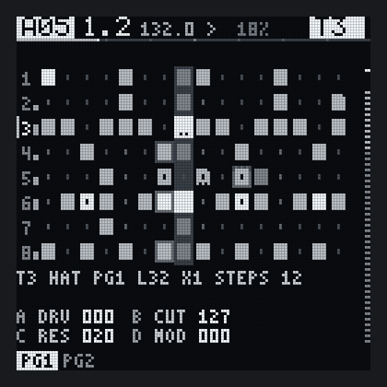
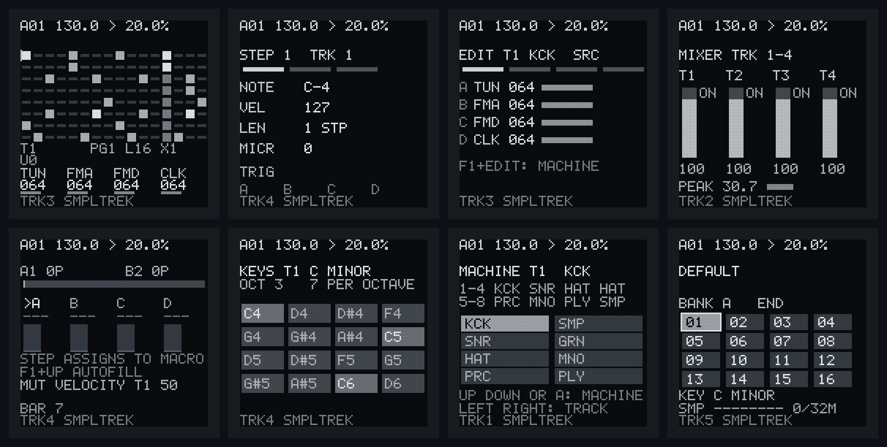

# STRATA

**An 8-track techno performance groovebox for the Sonicware SmplTrek**

Synthesized drums, basses and chords next to samples, a step sequencer with parameter locks and
trig conditions, and a performance layer built for long live sets. An
[Enaga](https://github.com/seawaffle/enaga) app.

[Try it](#try-it) · [Highlights](#highlights) · [Documentation](#documentation) ·
[Status](#status)

The device build in the emulator, 28 s: GRID, GENERATE, PERFORM, MIXER, EDIT, ARPS.

> [!NOTE]
> **STRATA is a beta, close to 1.0.** It has run on the SmplTrek since its first release, a
> community tester reports it running on a CyDrums too, and installing it is an ordinary system
> update that an official update fully undoes. As with any third-party firmware, you install it
> at your own risk ([disclaimer](#disclaimer)); the [install guide](docs/INSTALL.md) has a few
> quick checks to do first.

## What it is

The SmplTrek's stock firmware is sample-only. [Enaga](https://github.com/seawaffle/enaga) is
replacement firmware that turns the unit into a platform for apps. STRATA is one of those apps:
a groovebox that puts synthesized drums, basses and chords next to samples, lets every step
change the sound, and adds mutes, scenes, macros, a performance mixer and a looper so that a set
can keep evolving without stopping.

The factory project playing: frames of the device build running in the emulator.

## Try it

**The easy way: [strata.einblick.dev](https://strata.einblick.dev).** Pick a release, and your
browser fetches STRATA and the Enaga firmware it needs from their official GitHub releases,
checks both, and hands you one zip: copy everything in it to the root of the SD card, hold
**HOME** while switching on, choose **SYSTEM UPDATE**, and switch on again. For an update on the
same Enaga version, tick "STRATA only". The starter content, ticked by default, adds ten
projects to jam on (techno, deep house, dub, ambient, electro, synthwave, breakbeat), a sample
pack rendered by STRATA's own machines, and a one-page quick start.

**By hand:** STRATA needs two downloads: **Enaga 0.4.0**, the firmware, from Enaga's own release, and the
**STRATA zip**, which holds only the app.

1. **Install Enaga 0.4.0** (once). Download `enaga-v0.4.0-smpltrek.zip` from
   [Enaga's v0.4.0 release](https://github.com/seawaffle/enaga/releases/tag/v0.4.0), copy the
   `SmplTrek.bin` inside it to the root of the SD card, hold **HOME** while switching on, and
   choose **SYSTEM UPDATE**.
2. **Download STRATA**: `STRATA-v0.5.0-smpltrek.zip` from
   [Releases](https://github.com/Devko/STRATA/releases).
3. **Copy the app** `SD-CARD/ENAGA/APPS/STRATA/APP.ENA` to `/ENAGA/APPS/STRATA/APP.ENA` on the
   card, and switch on. The factory project plays on PLAY.

Do the [quick checks](docs/INSTALL.md#before-you-install) before step 1. Updating from
STRATA 0.4.0 or earlier needs step 1 too (they ran on older Enaga versions); after that, an update is
step 3 only while the Enaga version stays the same, and your projects stay on the card. An
official SmplTrek update restores the unit completely, because neither Enaga nor STRATA writes
the SPI flash or touches the bootloader. Enaga's developer reports that flashing back and forth
is pretty safe as long as the bootloader is left alone
([details](docs/INSTALL.md#installing-strata-on-a-smpltrek)). [docs/INSTALL.md](docs/INSTALL.md) has every step, switching apps and going back.

## Highlights

- **Eleven machines on eight tracks, any machine on any track:** KICK, SNARE, HAT, PERC, SAMPLE,
  GRAIN, VA MONO, VA POLY, WAVE MONO, WAVE POLY and FM4, plus MID for an outboard synth.
  116 factory sounds load into one track at a time while the beat plays, and any two to eight
  tracks can choke each other.
- **A sequencer built for techno:** up to 64 steps per track with their own length, speed,
  swing and play mode (forward, reverse, ping-pong, random), parameter locks, trig conditions,
  ratchets and rolls over a step's length, accents, slides, chords, micro-timing, a Euclidean
  generator, live and motion recording (chords note for note, note-repeat rolls, a click and a
  count-in), triplet speeds, and 16 levels of undo.
- **Parts that write and move themselves:** GENERATE writes a drum or melodic part in the key,
  and EVOLVE mutates it every few loops, orbiting the part or drifting away from it. The
  arpeggiator has rhythms, accents, ratchets and fourteen factory arps.
- **KEYS:** both lower pad rows become a pressure-sensitive keyboard with the pattern's scale lit.
- **Performance:** fill, beat and note repeat, step stutter, mutes, scenes with an A/B morph,
  macros you learn by turning knobs, throws, seeded mutation you keep or revert, LOCK (store the
  moment, jump back in one tap), ENERGY (one knob that thins the beat to a breakdown or fills
  it towards the peak, never touching the pattern), TRANSPOSE (the melodic tracks into another
  key from any screen), VariSpeed (tempo and pitch together, like a turntable), and a
  performance mixer on VALUE with fourteen effects, the morph and a looper.
- **Mixing:** a sidechain duck, delay, reverb and chorus sends (with LONG delay and HALL reverb
  modes for ambient), stereo spread or unison on the polyphonic machines, and a master with a DJ
  filter, kill EQ, compressor and limiter.
- **Samples and projects:** a sample browser that also reaches the stock SmplTrek folders,
  slicing (SLC AUTO cuts a break at its hits), streaming for long files, resampling, freeze and
  bounce, JAM REC (the whole set to a WAV on the card, for hours), and projects with autosave.
- **Timing is sacred:** steps land on an exact sample of Enaga's clock, and MIDI clock or SYNC IN
  can lead.
- **Help on every screen:** hold FUNC to see what the knobs and keys do where you are.

The full tour, with the factory kit and every effect, is in
[docs/OVERVIEW.md](docs/OVERVIEW.md).

## Documentation

**Playing it**

- [User manual](docs/MANUAL.md): concepts, a first-beat tutorial, every machine, performing,
  saving and troubleshooting
- [Cheatsheet](docs/CHEATSHEET.md): every gesture, screen and abbreviation, to keep next to the
  unit
- [Installing](docs/INSTALL.md) and [what changed in each release](CHANGELOG.md)
- [Features and their status](docs/FEATURES.md): what exists and what has been checked on the
  unit

**Working on it**

- [Building and testing](docs/BUILDING.md)
- [Handoff](docs/HANDOFF.md): where it stands and what comes next; contributors start here
- [All documents](docs/README.md)

## Status

<!-- release-status: tools/publish_release.sh rewrites the next line -->
**[v0.5.0](https://github.com/Devko/STRATA/releases/tag/v0.5.0)**, released 2026-11-27, is the current release, for **Enaga 0.4.0**.
Development continues on `main` before a stable 1.0 ([CHANGELOG.md](CHANGELOG.md), "Unreleased",
has what is new since the release), and [docs/PLAN.md](docs/PLAN.md) has the way to 1.0.
Releases have run on the unit: the default beat loads the CPU under 30%, and long, heavy play on
an earlier build peaked at 84.3% with no dropouts. The [unit checklist](docs/UNIT_CHECKLIST.md)
records which features have been walked through on the hardware.
[CHANGELOG.md](CHANGELOG.md) lists what changed in each release.

## Disclaimer

STRATA is an independent hobby project. It is **not affiliated with, endorsed by or supported by
Sonicware**. Sonicware, SmplTrek, Lofi-12 XT and CyDrums are trademarks of their respective
owners and are used here only to say which hardware STRATA runs on.

STRATA is provided **as is, without warranty of any kind**, and with no guarantee that it works,
keeps your data safe or suits any purpose (see [LICENSE](LICENSE)). You install and use it at
your own risk; the authors are not liable for any damage to your device, your data or anything
else. Please do not contact Sonicware support about STRATA or Enaga.

## Licence

MIT, see [LICENSE](LICENSE). STRATA is built on **[Enaga](https://github.com/seawaffle/enaga)**
(MIT) and its drum synthesis follows **Mutable Instruments Plaits** (MIT, © 2016 Émilie Gillet),
reimplemented rather than ported. [THIRD_PARTY_NOTICES.md](THIRD_PARTY_NOTICES.md) carries both
notices and says exactly what was taken from each.
