# STRATA cheatsheet

Built from the key handlers and draw code in `app/app.hpp`, so it says what the build does, not
only what docs/SPEC.md planned. Keys are named as printed on the SmplTrek. `FUNC+X` means hold
FUNC and press X; "hold STEP" means a STEP key held down while you do the rest.
[MANUAL.md](MANUAL.md) explains the concepts behind these and walks through a first beat.
[CONTROLS.md](CONTROLS.md) is the concept they follow: each group of buttons has one job in
every mode, and FUNC + a function key is the label printed under it.

## Key legend

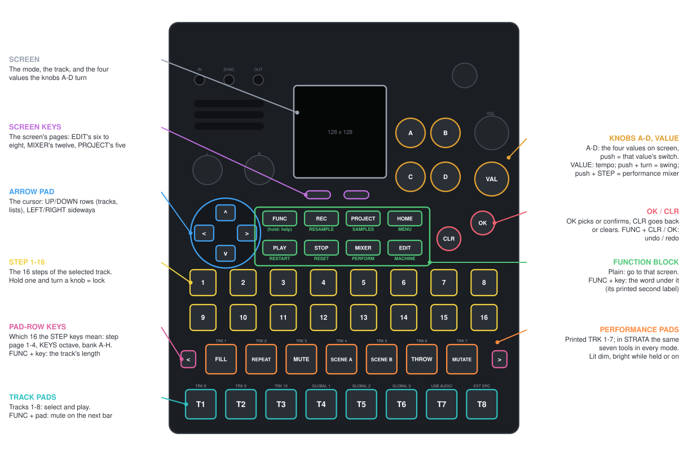

| Panel label (SmplTrek) | Code / SPEC name | Where |
| --- | --- | --- |
| FUNC, REC, PROJECT, HOME | F1, F2, F3, F4 | Function block, upper row, left to right |
| PLAY, STOP, MIXER, EDIT | F5, F6, F7, F8 | Function block, lower row, left to right |
| OK, CLR | OK, CLR | Right of the function block |
| UP, DOWN, LEFT, RIGHT | the arrows | Cursor keys |
| Pad-row keys L / R | OCTAVE_LEFT / RIGHT | At the two ends of the upper pad row (printed as octave): which 16 the STEP keys mean |
| Screen keys L / R | SELECT_LEFT / RIGHT | The two buttons under the screen: the screen's pages |
| A, B, C, D | encoders A-D | Four knobs; each also pushes |
| VALUE | encoder 4 | The VALUE knob; it also pushes |
| STEP 1-16 | STEP keys | The 16 step buttons |
| Pads | lower 1-8, upper 1-7 | Lower row = tracks 1-8, upper row (printed TRK 1-7) = performance |

The Lofi-12 XT and CyDrums print other names on the function block; this sheet uses the SmplTrek's.
The F-key labels are from Enaga's `docs/hardware.md`, taken from the original firmware's test page.
The on-screen hints use the same names (`FUNC+EDIT: MACHINE`). Each function key's second
printed label (REC "sampling", PROJECT "pool", HOME "system" ...) is what FUNC + that key does.
Hold FUNC alone for a moment and the screen lists them, with what the upper pads are.

## Modes: how to get there

| Mode | Keys | What it is for |
| --- | --- | --- |
| GRID | HOME (from anywhere) | All 8 tracks; STEP keys edit the selected track |
| KEYS | HOME twice quickly (double-tap) | The pads are a piano (lower white, upper black keys), the STEP keys 16 scale degrees, on the selected track |
| FUNC menu | FUNC+HOME ("system") | Save, save as, open, new, reload, kits, sample reload, track speed, chain, song, auto-fill, quantize |
| EDIT | EDIT | The selected track's sound: pages SRC, FLTR, AMP, FX, its LFO and its ARP |
| MACHINE | FUNC+EDIT | Pick the machine on each track, and its MIDI OUT channel |
| KIT | FUNC+EDIT twice, or the menu's KITS | Save and recall whole kits: 16 slots on the card, shared by all projects |
| SAMPLES | FUNC+PROJECT ("pool"), or OK in EDIT or MACHINE on a SMP or GRN track | Pick the track's WAV from `/SAMPLES` or `/RECORD` |
| MIXER | MIXER | Levels, delay, reverb, routing, master |
| PERFORM | FUNC+MIXER | Scenes, morph, macros, mutation |
| PROJECT | PROJECT | Banks and patterns, key and scale, the card |
| CHAIN | PROJECT, then screen key RIGHT | The pattern chain as a list |
| PATTERN | PROJECT, screen key RIGHT twice | Master length (LEN), swing (SWG) and each track's own swing of the playing pattern |
| SETUP | PROJECT, screen key RIGHT three times | Record quantize; shows clock and MIDI settings |
| PROJECTS | PROJECT, screen key RIGHT four times, or the menu's OPEN PROJECT | Open another project from the card, or save this one under a new name |
| RESAMPLE | FUNC+REC ("sampling") | Record the output, or the audio input, to a file or a track |
| Step page | Hold STEP + OK | One step's own fields (opens over GRID) |
| Enaga menu | FUNC+POWER | CLOCK SRC, CLOCK/SYNC OUT, MIDI CH |

## Screens

Drawn by the app's own screen code on the host build, on the factory project
(`tools/screenshots.sh` redraws them). The cheatsheet's "The screen" table below explains what
each line means.

<table>
<tr><td align="center">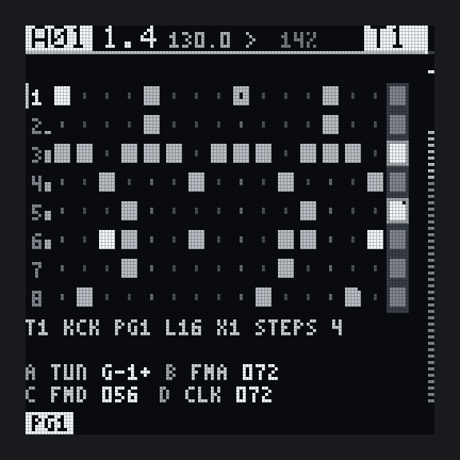 GRID</td><td align="center">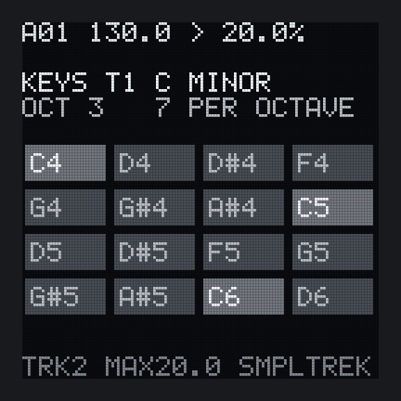 KEYS (HOME twice)</td><td align="center">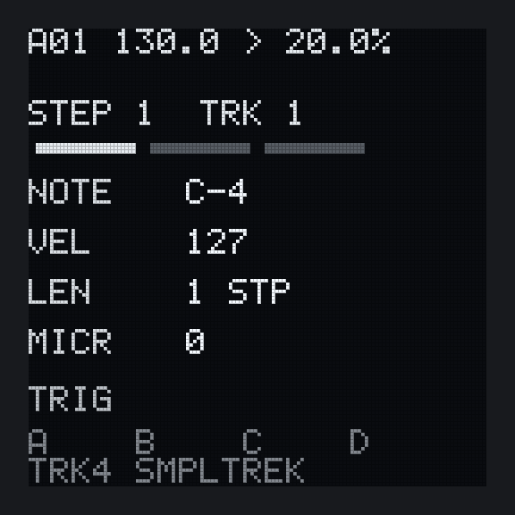 Step page (hold STEP + OK)</td></tr>
<tr><td align="center">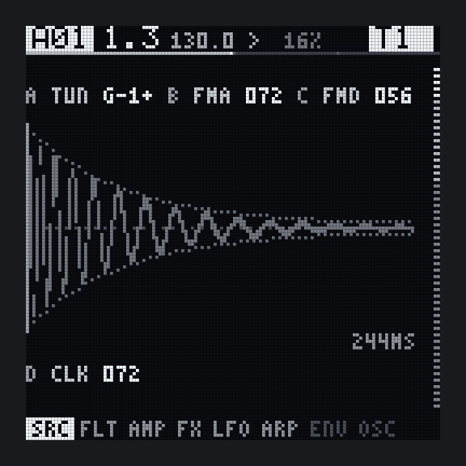 EDIT, SRC</td><td align="center">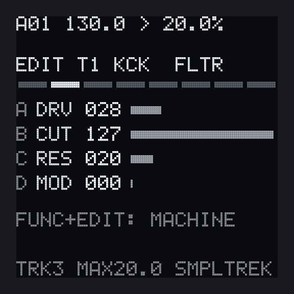 EDIT, FLTR</td><td align="center">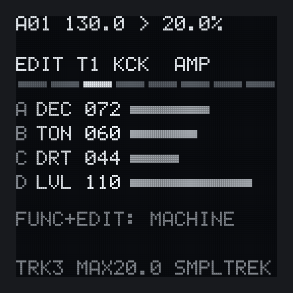 EDIT, AMP</td></tr>
<tr><td align="center">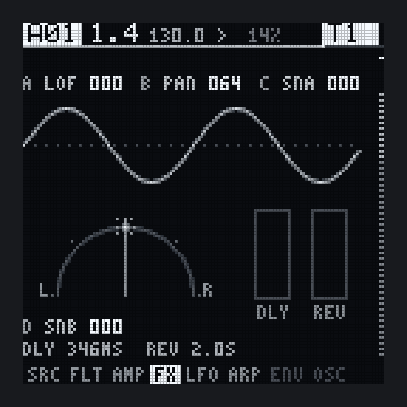 EDIT, FX</td><td align="center">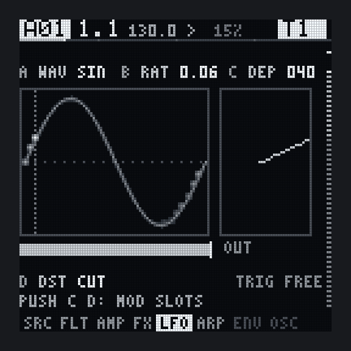 EDIT, LFO</td><td align="center">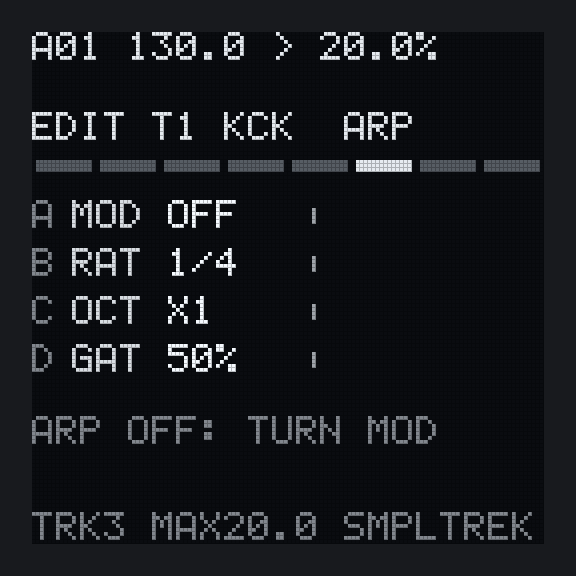 EDIT, ARP</td></tr>
<tr><td align="center">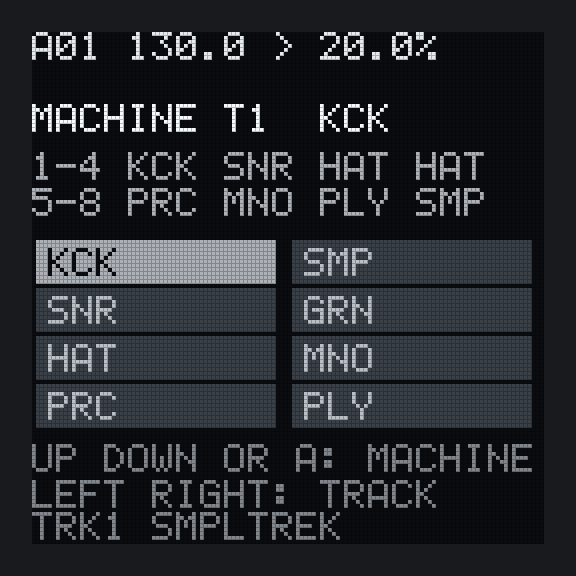 MACHINE (FUNC+EDIT)</td><td align="center">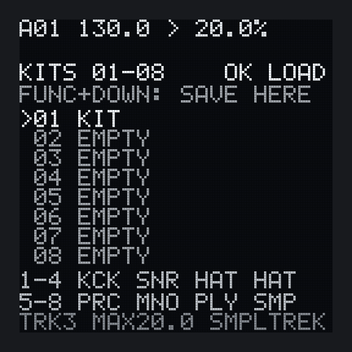 KIT (FUNC+EDIT twice)</td><td align="center">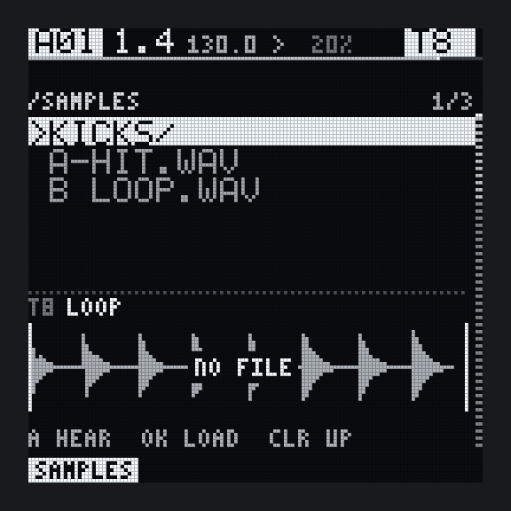 SAMPLES (FUNC+PROJECT)</td></tr>
<tr><td align="center">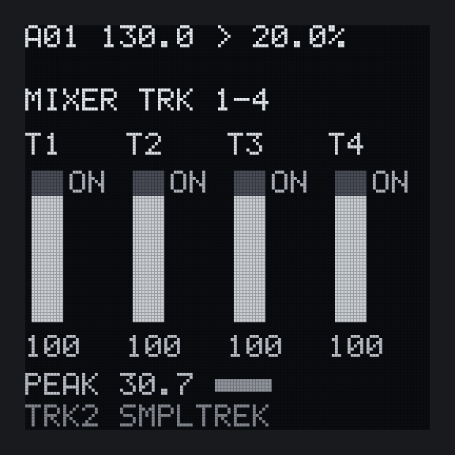 MIXER, TRK 1-4</td><td align="center">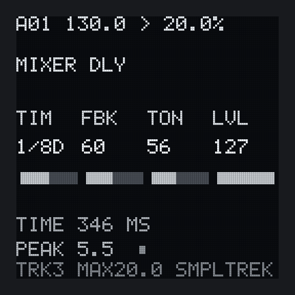 MIXER, DLY</td><td align="center">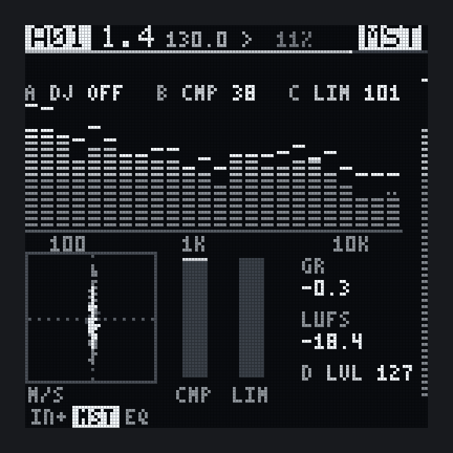 MIXER, MST</td></tr>
<tr><td align="center">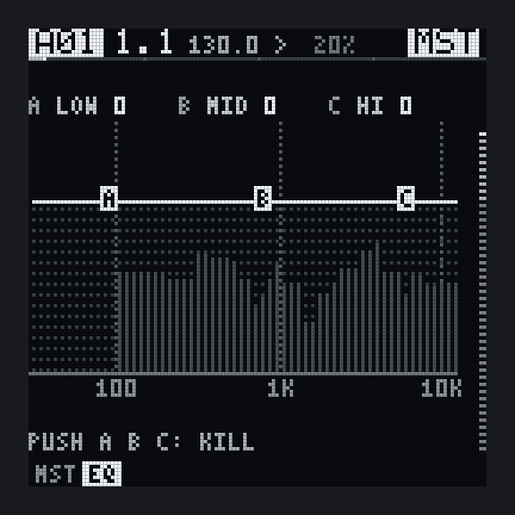 MIXER, EQ</td><td align="center">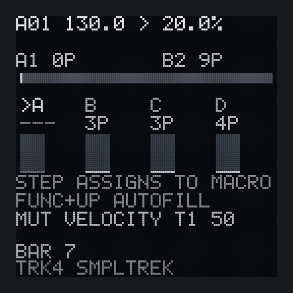 PERFORM (FUNC+MIXER)</td><td align="center">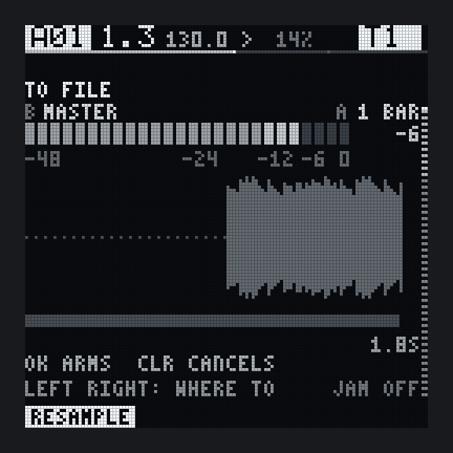 RESAMPLE (FUNC+REC)</td></tr>
<tr><td align="center">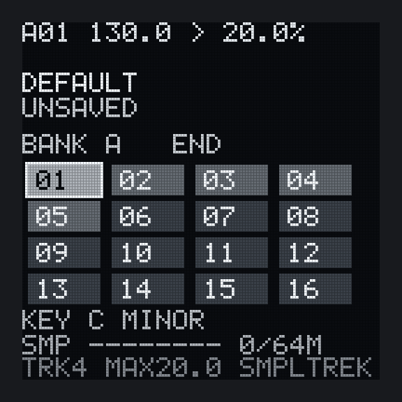 PROJECT</td><td align="center">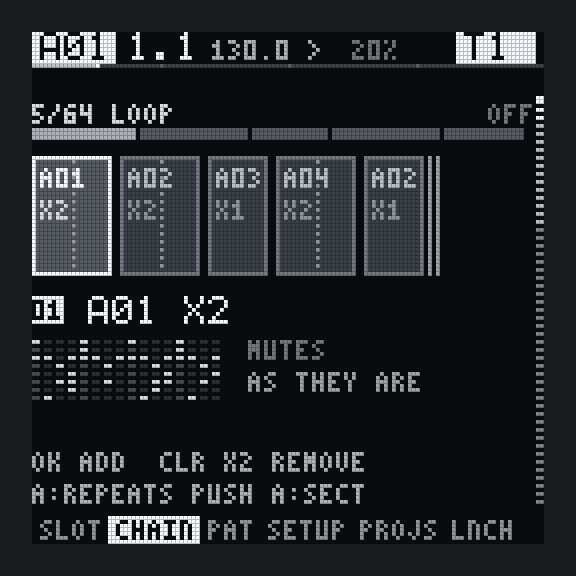 CHAIN</td><td align="center">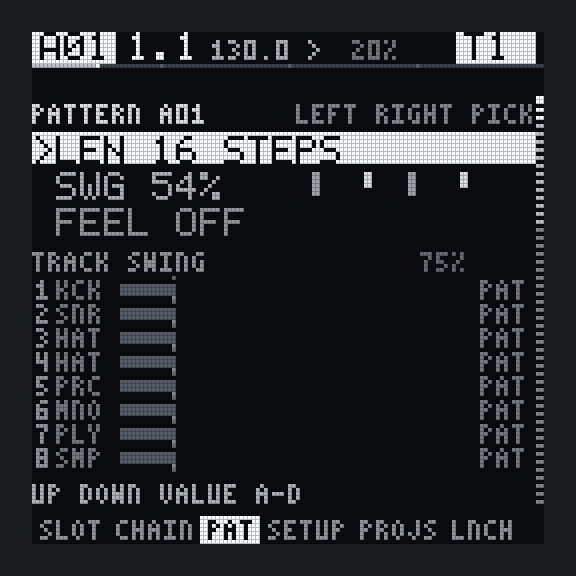 PATTERN</td></tr>
<tr><td align="center">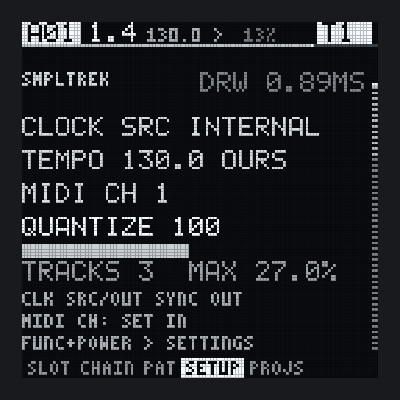 SETUP</td><td align="center">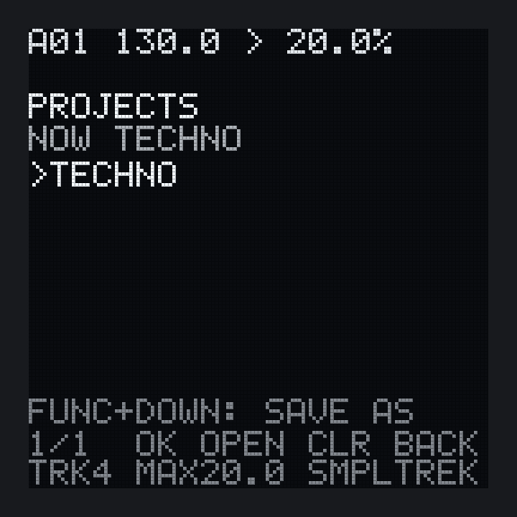 PROJECTS</td><td align="center">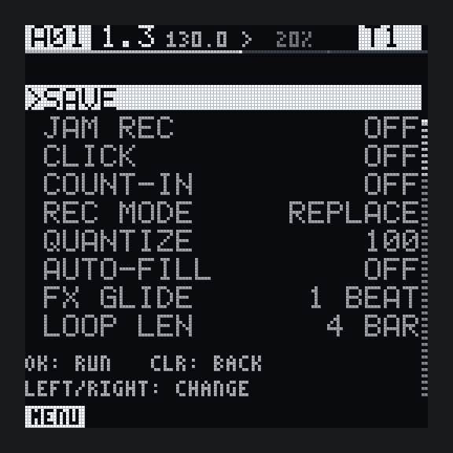 FUNC menu (FUNC+HOME)</td></tr>
<tr><td align="center">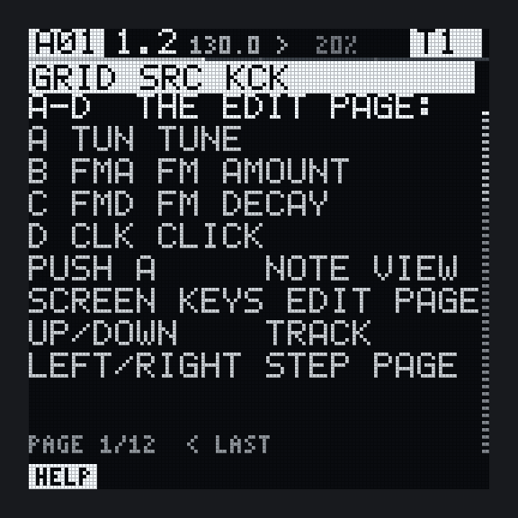 FUNC held alone</td><td align="center">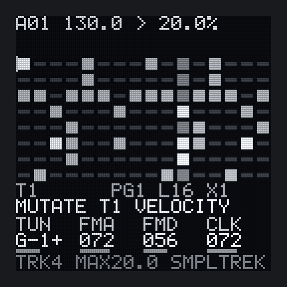 MUTATE pressed</td><td align="center">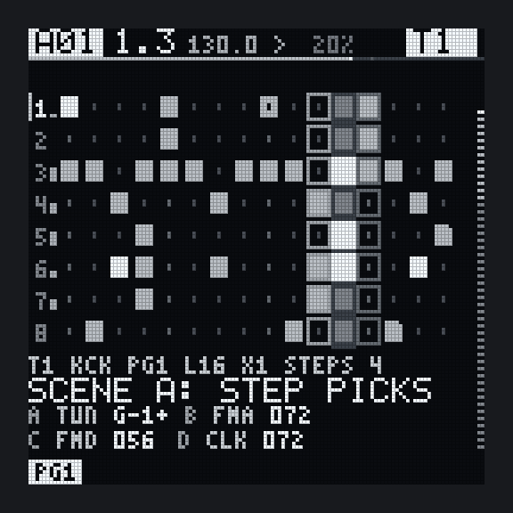 SCENE A held</td></tr>
</table>

## Keys that work everywhere

| Keys | Action |
| --- | --- |
| PLAY / STOP | Play / stop. STOP again cuts the tails. Refused under an outside clock (EXT CLOCK) |
| FUNC+PLAY | Restart from step 1, playing or not (RESTART) |
| FUNC+STOP | Stop, cut the tails, drop a queued change, back to step 1, a running chain back to its first entry (RESET) |
| REC | Live record on/off (REC on the edit line, REC lit red) |
| FUNC+HOME, OK | Save the project (the FUNC menu opens on SAVE) |
| FUNC+CLR / FUNC+OK | Undo / redo, in every mode and page |
| VALUE turn | Tempo, 20-300 BPM in 0.1 steps (PERFORM: morph) |
| VALUE push + turn | Pattern swing |
| FUNC + VALUE | Master DJ filter (LP n / OFF / HP n) |
| FUNC + push A / B / C | Master kill EQ: kill LOW / MID / HI, again to bring it back (`KILL LOW`, `LOW BACK`). Performance only: not saved, and a load brings every band back |
| FUNC + push D (hold) | Tape stop: the master slows to a standstill over two beats; let go and it is back (`TAPE STOP`). Not while a STEP is held: that clears the D lock |
| FUNC + pad-row L/R | Selected track's length (polymeter), on every screen but the menu |
| Arrow pad | UP/DOWN move through rows, LEFT/RIGHT sideways, OK picks, CLR goes back |
| Screen keys L/R | The screen's pages (on GRID and KEYS: the EDIT page A-D turn) |
| Pad-row keys L/R | Which 16 the STEP keys mean: step page, octave (KEYS), bank (PROJECT, CHAIN) |
| FUNC + UP / DOWN | Copy / paste while editing; in the card lists, read again / store here |
| FUNC held alone | Help: what FUNC + each function key does, and what the upper pads are |

## Pads

The upper pads are printed TRK 1-7, but in STRATA they are the performance pads. Each is lit
dim in its own colour (FILL white, REPEAT cyan, MUTE red, SCENE A green, SCENE B blue, THROW
amber, MUTATE violet), bright while held or while its mode is on, and names itself on the
screen when pressed.

| Pad | Plain | With FUNC / held |
| --- | --- | --- |
| Lower 1-8 | Select the track and play its root note; pressure bends macro A up | FUNC: mute or unmute on the next bar. In NOTE RPT: rolls while held at REPEAT's length, pressure is the velocity |
| Upper 1 FILL (printed TRK 1) | Fill while held | FUNC: NOTE RPT on/off (`NOTE RPT`, `PADS PLAY`; `NRPT` on PERFORM's bar line) |
| Upper 2 REPEAT (TRK 2) | Beat repeat while held; VALUE picks 1/4 ... 1/16T | FUNC at the press: pitch drops |
| Upper 3 MUTE (TRK 3) | Toggles MUTE MODE: lower pads mute at once | In MUTE MODE: STEP 1-8 recall a mute state, FUNC+STEP on the next bar, push VALUE+STEP stores |
| Upper 4/5 SCENE A/B (TRK 4/5) | Hold + STEP 1-16 picks that side's scene | In PERFORM: hold + OK captures the selected track only, hold + CLR erases the scene |
| Upper 6 THROW (TRK 6) | Delay throw while held | FUNC: reverb throw |
| Upper 7 MUTATE (TRK 7) | Mutates the selected track (type and amount set in PERFORM): `MUTATE T1 VELOCITY`, then `OK KEEPS CLR REVERTS` and the pad bright until you answer; `T1 NOTHING TO MUTATE` when it changed nothing (an empty track, amount 0). The default type, VELOCITY, is subtle on drums: ROT LEFT/RIGHT or DENSITY show on the grid | Then OK keeps it (KEPT), CLR reverts it (REVERTED); any mode but PROJECT, KIT and SAMPLES, and not while a STEP, a range or a scene pad is held or in RESAMPLE, where OK and CLR keep their own jobs. Any other edit also keeps it. FUNC (hold): delay freeze, the echoes loop and nothing new goes in (`FREEZE`, `FRZ` on PERFORM's bar line) |

## Step editing (GRID, EDIT, MIXER, MACHINE, RESAMPLE)

| Gesture | Action |
| --- | --- |
| Tap STEP | Toggle trig. FUNC + tap: toggle trigless (locks, no note) |
| Pad-row L/R (or LEFT/RIGHT on GRID) | Step page 1-4 (64 steps) |
| Hold STEP + turn A-D | Lock that parameter of the current EDIT page on the step |
| Hold STEP + push A-D | Remove that one lock (LOCK CLEARED), with or without FUNC held |
| Hold STEP + turn VALUE | Set the step's note |
| Hold STEP + OK | Open the step page on that step |
| Hold STEP + CLR | Clear the step |
| Hold STEP + UP / DOWN | Copy / paste the step |
| Hold two STEPs | Select the range between them (SEL a-b) |
| Range + CLR / FUNC+UP / FUNC+DOWN | Clear / copy / paste the range |
| Range + A / B | Transpose / nudge micro-timing of the range |
| CLR, nothing held | Clear the whole track (FUNC+CLR brings it back) |
| FUNC+HOME, CLEAR PATTERN, OK twice | Clear every track of the pattern; sounds, lengths and speeds stay (FUNC+CLR brings it back) |
| FUNC+UP / FUNC+DOWN, nothing held | Copy / paste the whole track |
| REC on, playing, turn A-D | Motion record: locks land on the playing step |
| FUNC + A / B / C (GRID) | Euclidean fill: hits, steps, rotation (EUC h/s Rn) |

**Step page.** A-D edit four fields; the screen keys flip the three field pages; LEFT/RIGHT move
to the previous/next step; OK or CLR close it.
Page 1 NOTE VEL LEN MICR, page 2 PROB COND RTCH RAMP, page 3 ACNT SLID CHRD.

## Per mode

| Mode | UP / DOWN | LEFT / RIGHT | Screen keys L/R | Pad-row L/R | A-D | OK / CLR | FUNC + arrow |
| --- | --- | --- | --- | --- | --- | --- | --- |
| GRID | Track | Step page 1-4 | EDIT page (for A-D) | Step page | Current EDIT page params | — / clear | Copy / paste |
| EDIT | Track | Page SRC FLTR AMP FX LFO ARP | Page | Step page | The page's 4 params | SMP/GRN: open SAMPLES / clear | Copy / paste |
| KEYS | Track | Octave (OCT 0-7) | EDIT page (for A-D) | Octave | Current EDIT page params | — | Copy / paste |
| MACHINE | Machine | Track | Track | Step page | A: machine, B: MIDI OUT channel (OFF, 1-16) | SMP/GRN: open SAMPLES / — | Copy / paste |
| KIT | Slot | Page of 8 slots | Page of 8 slots | — | A: slot | Recall (twice) / back to MACHINE | DOWN: save here, UP: read the card again |
| MIXER | — | Page (9) | Page | Step page | Levels or page fields; on EQ, push A-C kills a band; on DLY+ and REV+, push A flips the mode | — / clear | Copy / paste |
| SAMPLES | Entry | Page of 8 | Page of 8 | — | A: entry | Load file or open folder / up a folder (at the top: back) | UP: read the folder again |
| RESAMPLE | Bars 1/2/4/8 | Destination FILE, TRK 1-8 | Destination | Step page | A: bars, B: source, C: input level | Arm / cancel | Copy / paste |
| PROJECT | Slot cursor by row | Slot cursor | Page: PROJECT CHAIN PATTERN SETUP PROJECTS | Bank A-H | A: queue mode, B: key, C: scale | Queue slot / cancel queue | — (FUNC menu) |
| CHAIN | Entry | Entry's pattern -/+ | Page | Bank A-H | A: repeats X1-X16, B: mute recall --/M1-M8 | Add entry / remove entry (twice; empty: back) | — (FUNC menu) |
| PATTERN | Change field -/+ | Field LEN / SWG / track 1-8 swing | Page | Bank A-H | A: LEN 1-64, B: SWG, C: track swing (PAT, 50-75) | — / back | — |
| PERFORM | Mutation type | Macro A-D | Mutate amount (±10) | — | Macros A-D | Capture scene / clear macro | — (auto-fill: FUNC menu) |
| FUNC menu | Row | Change a setting row | — | — | A: row, B: change | Run the row / close | — |

**KEYS:** the pads are a piano: lower 1-8 C D E F G A B C, upper C# D# (octave down) F# G# A# (octave up), at the pad's velocity, held while down, pressure bends macro A; lit as a keyboard (root bright, scale dim, held white); FUNC + pad keeps its usual job. STEP 1-16 play the scale from the root and hold the note until released; the pad-row keys (or LEFT/RIGHT) change the octave of both. Letting go also releases that note if the sequencer is playing it on the same track.
**PROJECT:** STEP 1-16 queue that slot of the shown bank; the pad-row keys change the shown
bank. The screen keys walk the pages PROJECT, CHAIN, PATTERN, SETUP, PROJECTS; CLR on any of
them goes back to the slots. In SETUP, A sets the record quantize. Chain on/off, the sample
reload, RELOAD PROJECT and NEW PROJECT are in the FUNC menu (FUNC+HOME); the last two throw away
unsaved work, so each needs OK twice within 2 s (OK AGAIN TO RELOAD, OK AGAIN FOR NEW).
**FUNC menu (FUNC+HOME):** SAVE, SAVE AS, OPEN PROJECT, NEW PROJECT, RELOAD PROJECT, CLEAR
PATTERN, KITS, RELOAD SAMPLE, TRACK SPEED, CHAIN, CHAIN END, AUTO-FILL, QUANTIZE. UP/DOWN or A
scroll, OK runs the row (NEW, RELOAD and CLEAR PATTERN need OK twice), LEFT/RIGHT or B change a
setting row (OK steps it too),
CLR or FUNC+HOME close it, back to the screen it opened over. It always opens on SAVE.
**PROJECTS:** UP/DOWN or A move, LEFT/RIGHT page by 8. OK twice within 2 s opens the project
under the cursor (AGAIN TO OPEN; it throws away unsaved work and stops the transport).
FUNC+DOWN (or the menu's SAVE AS) is SAVE AS: A or LEFT/RIGHT move, B, VALUE or UP/DOWN change the character, OK saves
under that name (NAME TAKEN if another project has it), CLR cancels. FUNC+UP reads the card again.
**CHAIN:** a STEP key puts that slot of the shown bank into the entry under the cursor (or starts
the chain); VALUE also sets repeats; OK adds a copy after the cursor (the playing pattern when
empty), up to 64 entries. CLR twice within 2 s removes the entry under the cursor (`AGAIN TO REMOVE`, then `ENTRY REMOVED`; not undoable); on an empty chain CLR goes back. B recalls a mute state as the entry starts. The FUNC menu's CHAIN turns the chain on and off, and CHAIN END
switches SONG (play the chain once and stop, `SONG END`) and LOOP. Chain edits are not undoable.
**PATTERN:** VALUE also changes the field under `>`. LEN is the master length that a queued change
(END) and the chain wait for. The eight TRACK SWING fields read `PAT` (follow SWG) or 50-75%: C
sets the one under `>`, or the selected track's when `>` is on LEN or SWG.
**PERFORM:** STEP 1-16 assign that parameter of the selected track to the selected macro; FUNC + STEP 1-4 assign its LFO's WAV RAT DEP DST;
FUNC+STEP 5-7 the master kill EQ's LOW, MID or HI (`A EQ LOW`). OK's whole capture also stores the
kill EQ's three knobs, so the morph can sweep them. A macro
at 0 lets go: its parameters follow their EDIT knobs and the morph, and turning it up sweeps from
wherever they are. A new project has B ACID (bass filter), C DUB (chord and rim sends) and D DRIVE
(kick and hats); A is left for you, and pad pressure bends it. VALUE is the A/B morph; OK captures into scene A's slot (with a scene pad held: that scene, selected
track only); scene pad + CLR erases it. Mutes, mute states and the A/B scene choice are saved with
the project.
**KIT:** a kit is everything KIT.BIN holds: the eight machines, their parameters, the faders and
the sample paths. STEP 1-16 move the cursor to that slot (they never load). OK once shows OK AGAIN TO
LOAD; OK again within 2 s recalls the kit, and the transport keeps playing. A recall cuts the tails
and is not undoable, which is why it takes two presses. Tracks whose sample path changed reload
their sample in the background; the others keep playing theirs. FUNC+DOWN saves the current kit
into an empty slot at once, and over a stored kit on a second press (AGAIN TO OVERWRITE). The kits
live in `/ENAGA/DATA/STRATA/KITS/KIT_01.BIN` ... `KIT_16.BIN`. A recalled kit makes the project
UNSAVED until it is saved with FUNC+HOME, OK.
**SAMPLES:** one OK loads the file into the track at once, the beat keeps playing and the cursor
stays, so DOWN, OK tries the next. The top level holds `SAMPLES/` and `RECORD/`. Only WAVs and
folders are listed (no `._` files), at most 256 a folder. Picking a file makes the project UNSAVED.
**MIDI out:** a track with a MIDI OUT channel (MACHINE, encoder B) sends every note it plays
there: steps, chords, ratchets, arp hits, note repeat, pads, KEYS and MIDI IN. MID is the machine that plays nothing
itself; its SRC and AMP knobs send CC 74 71 73 72 and 70 75 76 77 when they move (locks too), and
its LFO sends its destination's CC as it moves, at most every 20 ms.
Notes end with their step length, a key or note let go, a mute, STOP; the second STOP and
FUNC+STOP also send All Notes Off. Enaga 0.2.0: unplug USB (or keep its MIDI port open on the
computer) when driving gear from the DIN jack.
**MIDI in:** channels 1-8 play tracks 1-8, other channels play the selected track. Notes are
held until their note-off. CC 16-31 set the track's 16 parameters (SRC, FLTR, AMP, FX in order);
CC 120/123 let go of held notes. Program change 1-128 on your MIDI CH queues pattern A01-H16.

## The screen

| Where | Example | Meaning |
| --- | --- | --- |
| Top line | `A01 130.0 > 23.4%` | Live bank+slot, tempo, `>` playing / `.` stopped, audio load |
| Line 2 | `EXT MIDI` `EXT SYNC` `CLOCK REFUSED` | Outside clock source; a transport call was refused |
| Bottom line | `TRK3 MAX23.5 SMPLTREK` / `TRK3 DROP 2` | Tracks sounding, the highest audio load since PLAY (held; PLAY starts it again), device; DROP = edits lost to a full command ring |
| GRID | `T1 MUTE PG1 L16 X1` | Track, muted, step page, length, speed |
| GRID edit line | `REC Q50 SEL 1-8 FULL 2 U3/R1` | Recording + quantize, selection, refused edits (lock pool full), undo/redo depth |
| Step page | `TRIG` `TRIGLESS` `OFF`, `LOCKS n` | What the step is and how many locks it holds |
| PROJECT | `BANK A   END CHAIN` | Shown bank, queue mode, chain running |
| CHAIN | `CHAIN 3/64 ON SONG`, `>02 A05 X2 M3 PLAY` | Entries used, chain on/off, plays once (SONG) or loops; cursor, entry, pattern, repeats, mute state recalled at its start, playing now |
| PATTERN | `>LEN 16 STEPS`, `SWG 54%`, `3 PAT`, `>5 66%` | Master length; swing; a track following SWG or with its own (`>` = field VALUE changes) |
| EDIT LFO | `NOW CUT 87`, `LFO OFF: SET DEP+DST` | The destination's value right now; DEP or DST is zero |
| EDIT ARP | `UP 1/16 X2 75%`, `ARP OFF: TURN MOD` | Mode, rate, octaves, gate; the arp is off |
| PROJECT slots | `05>`, bright box | Queued slot; live slot (bright), has trigs (mid), empty (dark) |
| PROJECT | `SMP OS.X- 12/32M` | Per track sample: O ready, S streamed from the card, . loading, X failed, - none; MiB used/budget |
| Any | `STREAM LATE` | The card fell behind a streamed file; the gap played as silence |
| PROJECT | `UNSAVED`, `NO CARD` | RAM differs from the card; no usable card |
| KIT | `>03 KIT`, `EMPTY`, `UNREADABLE`, `...` | Cursor and slot: holds a kit, nothing, a damaged file, not read yet; the cursor's kit below as two lines of four machines |
| PERFORM | `A1 12P`, `>A`, `3P` | Scene slot and its parameter count; selected macro; macro targets |
| PERFORM | `MUT NOTES T1 50`, `FILL AF16 1/16- DLY`, `BAR n` | Mutation, track, amount; fill, auto-fill, repeat (`-` pitched down), throw; bar count (`NRPT`: note repeat on, `FRZ`: delay frozen) |
| MIXER | `T1 M`, `ON`/`--`, `PEAK` | Track muted; machine present; master peak |
| MIXER EQ | `0`, `-20`, `+12`, `KILL` | Band flat, cut, boosted; killed by its switch or a knob at the bottom |
| SAMPLES | `/SAMPLES/KICKS`, `>K1.WAV`, `LOOPS/`, `NOW K1.WAV`, `3/40 +2` | Folder (or `READING FOLDER`, `NOT FOUND`, `NO CARD`, the load's progress); cursor; a folder; the track's file; position, count, entries left out |
| RESAMPLE | `TO FILE`, `ARMED`, `REC 40%`, `WRITING`, `LAST name` | Destination and take state |
| RESAMPLE | `FROM MASTER`, `FROM LINE NORM`, `IN` / `CLIP` + bar, `MIC NEEDS HEADPHONES`, `INPUT REFUSED` | Take source (MASTER LINE, LINE L, MIC, DYN MIC, HI-Z) and input level (LOW NORM HIGH); the input meter; the mic is silent without headphones; Enaga refused the route |

## Abbreviations

**Machines:** KCK kick · SNR snare · HAT hat · PRC 2-op FM percussion · SMP sampler · GRN granular ·
MNO VA mono · PLY VA poly.

**EDIT pages:** SRC source · FLTR filter (insert chain) · AMP amplitude · FX effects (insert chain) · LFO the track's LFO · ARP its arpeggiator.
**LFO page:** WAV shape SIN TRI RMP (rising) SAW (falling) SQR S+H · RAT rate, `0.06`-`32` Hz free on the lower half, `8B` (bars) to `1/32` synced on the upper (`.` dotted, `T` triplet) · DEP depth, 127 = about 64 either side · DST the parameter it moves, or OFF. Lockable, scene- and macro-able like any parameter.
**ARP page:** MOD OFF UP DN U/D ORD RND · RAT `1/4` to `1/32T` · OCT `X1`-`X4` · GAT note length, `50%`-`99%` of the spacing. On, a step plays a run for its length (PLY: through its chord); in KEYS, held keys are arpeggiated. Lockable and scene-able.

| Machine | SRC (A B C D) | AMP (A B C D) |
| --- | --- | --- |
| KCK | TUN tune, FMA FM amount, FMD FM decay, CLK click | DEC decay, TON tone, DRT dirt, LVL level |
| SNR | TUN, SNP snappy, TON noise tone, CLP clap mode | DEC, SPR clap spread, BDY body, LVL |
| HAT | TUN, TON tone, NOI noise, DTN detune | DEC, CHO choke time, CHK choke group, LVL |
| PRC | TUN, RAT ratio, IDX FM index, IDD index decay | DEC, SWP pitch sweep, SWT sweep time, LVL |
| SMP | PIT pitch, STA start, LEN length, SLC slices (1 = one-shot; push D: AUTO cuts at the hits) | ATK attack, DEC, PLY play mode (fwd/loop/rev/rev loop), LVL |
| GRN | POS position, SIZ grain size, DEN density, SPR spray | PIT pitch, SHP grain shape, DEC, LVL |
| MNO | TUN, MOD filter mode, CUT cutoff, RES resonance | DEC, ENV filter env amount, GLD glide, LVL |
| PLY | TUN, MOD, CUT, RES | DEC, ENV, DET detune, LVL |

**Insert chain (every track):** FLTR = DRV drive, CUT cutoff, RES resonance, MOD filter mode
(OFF LP12 LP24 BP12 BP24 HP12 HP24). FX = LOF lo-fi, PAN pan, SNA send A (delay), SNB send B (reverb).

**Step fields:** NOTE · VEL velocity · LEN length (`1/16 STP` ... `64 STP`) · MICR micro-timing (±) ·
PROB probability % · COND condition · RTCH ratchet count · RAMP ratchet ramp (FLAT UP DOWN) ·
ACNT accent · SLID slide · CHRD chord.
**Conditions:** NONE, `a:b` (play on pass a of every b), FILL / NOT FILL, PRE / NOT PRE (this track's last
condition result), NEI / NOT NEI (the track to the left's), 1ST / NOT 1ST (first pass after a pattern change).
**Chords:** 1 NOTE, MIN, MAJ, SUS2, SUS4, DIM, MIN7, DOM7, MAJ7, MIN9, MIN11, 5TH, OCT, 5TH OCT; `/n` = inversion n.

**MIXER pages:** TRK 1-4, TRK 5-8 (levels) · DCK 1-4, DCK 5-8: each track's sidechain duck depth,
OFF-100% (SRC: the source, never ducked) · DUCK: SRC source track, ATK attack 1-50 ms, HLD hold
0-500 ms, REL release 10-1000 ms (saved in the kit) · DLY: TIM time (1/32 ... 1/1, T triplet, D dotted),
FBK feedback, TON tone, LVL · DLY+: TYP CLAS/LONG (push A flips it), MUL X1-X8 (LONG: time x MUL,
up to 12 s), WOW tape wobble, DIF diffusion · REV: DEC decay, DMP damping, HPF high-pass, LVL ·
REV+: TYP ROOM/HALL (push A), SIZ size, MOD sweep, SHM octave-up shimmer · ROUTE: PNG ping-pong,
D>R delay into reverb, LCT the LONG delay's low cut · MST master: DJ filter, CMP compressor, LIM limiter, LVL · EQ master kill EQ:
LOW (below 250 Hz), MID, HI (above 2.5 kHz), each flat at centre, KILL at the bottom, +6 dB at the top.

**Lists:** queue modes END (end of pattern), 16, 32 (steps), NOW · repeat 1/4 1/8 1/16 1/32 1/4T
1/8T 1/16T · auto-fill OFF 4 8 16 (bars) · mutations ROT LEFT, ROT RIGHT, DENSITY +, DENSITY -,
VELOCITY, MICRO, CHANCE, NOTES · scales CHROMATIC MINOR MAJOR DORIAN PHRYGIAN LYDIAN MIXOLYDIAN
LOCRIAN, HARM MINOR, MEL MINOR, MINOR PENT, MAJOR PENT, BLUES, WHOLE TONE, DIMINISHED · notes use
sharps (C# not Db).

---

STRATA is an independent project, not affiliated with or endorsed by Sonicware. SmplTrek is a
trademark of its owner. Provided as is, without warranty; use at your own risk (see LICENSE).
