# STRATA user manual

This manual explains how STRATA works and how to play it. It goes with
[CHEATSHEET.md](CHEATSHEET.md), which lists every gesture, screen and abbreviation on one page:
read this once, then keep the cheatsheet next to the unit.

It describes the current build, written from the code. STRATA is a beta close to 1.0: it runs
on the unit, and where a feature has not yet been walked through on the hardware this manual
says so.

**Key names.** Keys are named as printed on the SmplTrek: FUNC, REC, PROJECT, HOME, PLAY, STOP,
MIXER, EDIT, OK, CLR, the arrow pad (UP, DOWN, LEFT, RIGHT), the **screen keys** (the pair just
under the screen), the **pad-row keys** (the pair at the ends of the upper pad row, printed as
octave), encoders A-D and VALUE, STEP 1-16 and the pads. `FUNC+X` means hold FUNC and press X.
"Hold STEP" means hold a STEP key down while you do the rest. The cheatsheet's key legend maps
these to the F1-F8 names used in the code and in docs/SPEC.md.

**How the controls are laid out** ([CONTROLS.md](CONTROLS.md)). Each group of buttons does one
kind of thing everywhere: the arrow pad moves the cursor (OK picks, CLR goes back), the screen
keys turn the screen's pages, and the pad-row keys choose which sixteen the STEP keys mean (step
page or bank). FUNC + a function key does what is printed under that key: REC "sampling"
is RESAMPLE, PROJECT "pool" is the sample browser, HOME "system" is the **FUNC menu**, MIXER "fx"
is PERFORM. The rare setup actions (save as, open, new, reload, kits, chain on/off, song mode,
track speed, auto-fill, quantize) live in the FUNC menu, named on the screen. The upper pads are
printed TRK 1-7, but in STRATA they are the performance pads: each is lit in its own colour and
names itself on the screen when pressed. Hold FUNC alone for a moment for help on the screen you
are on: what the four knobs do there and the gestures it has. Keep holding FUNC and tap the screen
keys (or LEFT/RIGHT) for more pages; the last five are the same everywhere: FUNC + each function
key, FUNC + a knob or pad, the upper pads, and two pages on the performance mixer.


<p> 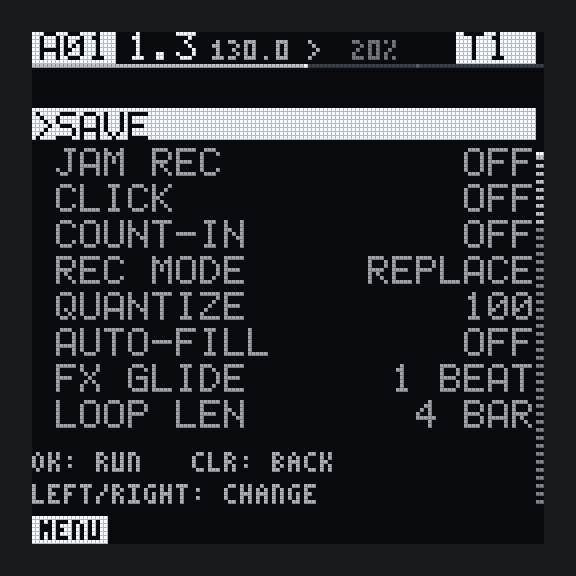</p>

<sub>Left: FUNC held alone on GRID: A-D and their words, then GRID's keys; the screen keys turn to
the steps, the STEP lights and FUNC + each key.
Right: the FUNC menu (FUNC+HOME), which always opens on SAVE.</sub>

**Contents**

1. [Core concepts](#1-core-concepts)
2. [Your first beat](#2-your-first-beat)
3. [The machines](#3-the-machines)
4. [The sequencer in depth](#4-the-sequencer-in-depth)
5. [Performing](#5-performing)
6. [Saving, loading and the card](#6-saving-loading-and-the-card)
7. [Performance tips](#7-performance-tips)
8. [Troubleshooting](#8-troubleshooting)


<sub>The factory project playing. Top: GRID, the step page, EDIT. Middle: MIXER, PERFORM (with the
factory macros B, C and D), KEYS. Bottom: MACHINE, the KIT browser, PROJECT. Every screenshot in
this manual is a frame of the device build running in the emulator (`tools/emulator_screens.sh`),
so it shows what the unit shows; MUTATE and SCENE, which need pads, are the host build's draw.</sub>

---

## 1. Core concepts

### Tracks

STRATA has **eight tracks**. The eight lower pads are the tracks, left to right: tap one to select
it and hear it. Each track holds one **machine** (the sound source) followed by the same fixed
**insert chain**: drive, a multimode filter, lo-fi, the amplitude stage, the sidechain duck, pan
and level. From there each track goes to the mixer, the two send effects (delay and reverb) and
the master bus: the DJ filter, a three-band kill EQ, the glue compressor, the limiter and the
output level.

The selected track is the one the STEP keys, the encoders, KEYS and MUTATE work on. UP and DOWN
also walk the tracks in GRID, EDIT and KEYS.

### Machines

<p> 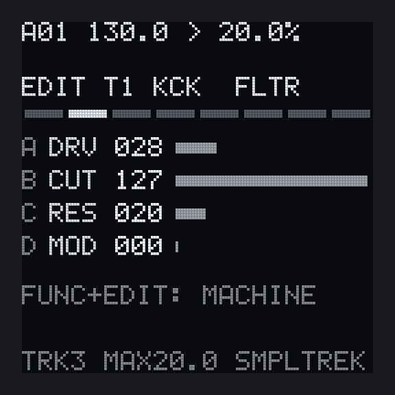</p>

<sub>EDIT on the kick: the machine's SRC page and the insert chain's FLTR page. The tabs along the bottom are the EDIT pages, the one showing lit; the screen keys turn them. A, B and C sit on the knob line at the top, D in the footer under the picture.</sub>

A machine is one of eleven sound engines, plus **MID**, which plays an outboard synth over MIDI
instead (section 3). Any track can host any machine (MACHINE mode, `FUNC+EDIT`). The default kit
uses eight of them, one per track (WAVE MONO and WAVE POLY are there to switch to).
**Switching a track to another machine loads that machine's default sound**: its SRC, FLTR and
AMP pages (and ENV and OSC where it has them) become the first entry of its SOUNDS list, and a
SMP track plays a sample whole from its start. The FX page (lo-fi, pan, sends), the LFO and the
arpeggiator stay as they were, and so does a MID track's page.

| Track | Machine | Default role |
| :---: | --- | --- |
| 1 | KCK (KICK) | Kick |
| 2 | SNR (SNARE) | Clap (the snare in clap mode) |
| 3 | HAT | Closed hat; it chokes track 4 |
| 4 | HAT | Open hat |
| 5 | PRC (PERC) | Rimshot |
| 6 | MNO (VA MONO) | Bass |
| 7 | PLY (VA POLY) | Chord stabs |
| 8 | SMP (SAMPLE) | Loop, cut into slices |

Every track has **16 parameters on four pages** of four, one parameter per encoder A-D, then a
fifth and a sixth page for its LFO and its arpeggiator (below). The VA, WAVE and FM4 machines add a
seventh and an eighth, ENV and OSC.

- **SRC** and **AMP** belong to the machine and change meaning with it (section 3).
- **FLTR** and **FX** belong to the insert chain: FLTR = DRV drive, CUT cutoff, RES resonance,
  MOD filter mode (OFF, LP12, LP24, BP12, BP24, HP12, HP24); FX = LOF lo-fi, PAN, SNA send A
  (delay), SNB send B (reverb).
- **The synth machines (MNO, PLY, WMN, WPL) have one filter, their own.** On them FLTR shows the
  voice's filter: CUT, RES, ENV and FDE (its decay). The insert filter shrinks to one knob,
  **TON** on SRC: 64 is flat, lower darkens (a low-pass down to 250 Hz), higher thins (a
  high-pass up to 1.5 kHz). An older project's insert filter on these tracks loads as the
  nearest TON.

Parameters run 0-127. Every change is smoothed over one audio block, so turning a knob or
playing a locked step never clicks.

### The LFO

<p>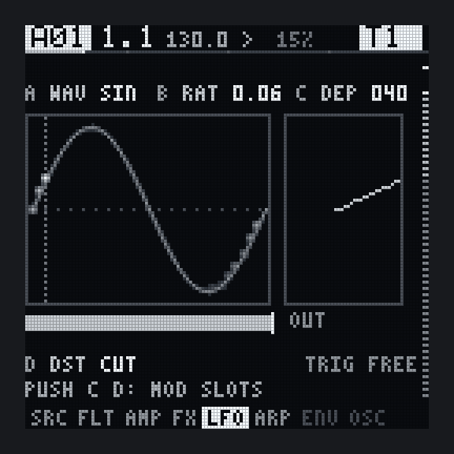</p>

Every track also has **one LFO**, on a fifth EDIT page, **LFO**, after FX (EDIT, then the
screen keys or LEFT/RIGHT). It moves one of the track's 16 parameters up and down on its own:

- **A, WAV**: the shape. SIN, TRI, RMP (a rising ramp), SAW (a falling one), SQR and S+H (a new
  random value each cycle). One click is one shape.
- **B, RAT**: the rate. The lower half runs **free**, from `0.06` Hz (one sweep every 16 s) up to
  `32` Hz. The upper half is **synced** to the tempo, from `8B` (eight bars) down to `1/32`, with
  dotted (`1/4.`) and triplet (`1/8T`) lengths in between. A synced LFO stays in time with the
  bar wherever the song is, follows an outside clock, and starts on the one when you press PLAY.
- **C, DEP**: how far. At 127 the parameter swings about 64 either side of where its knob is.
- **D, DST**: which parameter, by name, or `OFF`. One click is one parameter.

On a cutoff, DEP 127 swings about three octaves either side, and the LFO never takes the filter
below about 100 Hz (unless the knob itself is already lower): a deep sweep dips the sound rather
than shutting it off.

**Push B (RAT's knob) for TRIG**, when the cycle starts: **FREE** runs on its own as above;
**RETRIG** starts the cycle again on every note the track plays (a step, a chord, an arp or roll
hit, a pad or a key); **ONE-SHOT** runs one cycle from each note and then stops, which makes the
LFO a second envelope you can point at any parameter. In ONE-SHOT the shapes are envelopes that
start and end where the knob is: TRI rises to DEP and falls back (attack and decay), SAW jumps to
DEP and decays, RMP rises and stays up until the next note, SQR holds DEP for half the cycle, SIN
is one wobble and S+H picks a new value for each note and keeps it. RAT is its length: free, one
over the rate (`2.0` Hz is half a second); synced, the note length. A synced LFO in RETRIG or
ONE-SHOT counts from the note, not from the bar.

The footer says `TRIG FREE`, `TRIG RETRIG` or `TRIG ONE-SHOT` at its right (`SYNC` before it
on a synced rate), and the picture says `LFO OFF: SET DEP+DST` until both are up. A new track's LFO is off and
FREE, and so is every track in a project saved before it existed.

The four LFO settings are parameters like any other: hold a STEP and turn one to lock it on that
step (a deeper sweep on one step, a different shape for a fill), store them in a scene and morph
between two LFO settings, or put DEP on a macro to fade the movement in. TRIG is the kit's, like
SLC AUTO: no lock or scene changes it. The LFO moves the parameter in its 0-127 steps about 750
times a second, smooth on a filter or a pan. Pitch is the exception on VA and WAVE (MONO and
POLY): there the LFO on TUN bends the voices directly, so a slow sweep glides and a held note
follows it. On the other machines TUN still moves in its steps, and only from the next note.

### MOD slots: two per track

Every track has **two mod slots**. A slot is a source that moves one parameter by a depth:

- **LFO**: the track's LFO as it runs. Its own DEP can stay at 0, so it moves only what the slots
  say, and one LFO can then move two things at once, each by its own amount.
- **ENV**: the LFO page's shape and RAT, run once from each note whatever TRIG says. SAW is a
  decay, TRI an attack and decay, RMP a rise (see ONE-SHOT above). The LFO itself can run FREE
  at the same time.
- **VEL**: each note's velocity. The full depth at 127.
- **PRS**: the pressure on the track's pad while you hold it (in KEYS, any piano pad, on the
  selected track). Back to nothing when you let go.
- **RND**: a random value for each note, either side of the knob, held for the note.

**You set a slot by learning it**, the way MACRO LEARN works. On the LFO page **push C** (DEP's
knob) for slot 1 or **push D** (DST's) for slot 2. A toast says `MOD1 LFO: TURN A KNOB`. Push the
same knob again to walk the source: LFO, ENV, VEL, PRS, RND, OFF. Then go to any page of the same
track with the screen keys and **turn the knob you want moved**, as far as you want the source to
take it: the toast follows (`MOD1 VEL>CUT +40`). **OK** or **CLR** ends it (leaving EDIT does too):
the knob goes back to where it was and the slot keeps the difference as its depth, so the knob
is the sound at rest and the source moves it from there. Turn down for a negative depth: loud
notes then close the filter instead of opening it. Pushing C or D from GRID or KEYS opens EDIT.

Ended with no knob turned, a slot that is already set keeps its knob and depth and takes the new
source, so a push or two and OK changes only the source. Walk the source to **OFF** and press OK
to clear the slot (`M1 OFF`). Ended with nothing set, it says `NO KNOB: M1 STAYS OFF`.

A slot can move the 16 sound parameters and, on the machines that have them, ENV and OSC. Not
the LFO's own knobs or the arp's (`MOD: NOT LFO OR ARP`). The two slots and the LFO add up. On a
cutoff a slot stops at the same ~100 Hz floor as the LFO, and on VA and WAVE a slot on TUN bends
the voices smoothly, as the LFO does.

**On screen:** the LFO page lists both slots (`M1 VEL>CUT +40`, `M2 OFF`) in place of the LFO's
picture. On every EDIT page a parameter with a slot on it has a dim line under its bar across the
range the slot can move it, and a bright dot on that line where it is now. The slots are the
kit's, saved with it, like LFO TRIG: no lock, scene or macro changes them. A project saved before
they existed loads with both slots off.

### The arpeggiator

<p></p>

Every track also has an **arpeggiator**, on a sixth EDIT page, **ARP**, after LFO. It turns a
note into a run of notes:

- **A, MOD**: OFF, UP, DN (down), U/D (up and back down), ORD (in the order played) or RND. One
  click is one mode.
- **B, RAT**: the spacing of the notes, `1/4` down to `1/32T`. Always in time with the tempo.
- **C, OCT**: how many octaves the run climbs, `X1` to `X4`.
- **D, GAT**: how long each note is, from `50%` of the spacing (staccato) to `99%` (legato).

The picture draws the run's notes; the footer's right says how many octaves it climbs (`X2 OCT`),
and the page says `ARP OFF: TURN MOD` while the arp is off.

**On the sequencer**, a step on a track whose arp is on plays its note as a run for the step's
length: set a step's length to 4 steps and a 1/16 arp plays four notes. On the PLY track the run
walks the step's chord, one note at a time. The track's next step starts a new run. RND plays the
new notes on every pass of the pattern.

**In KEYS**, hold pads and the arp plays them, adding each pad you press to the run and dropping
each one you let go; it stops when the last key comes up. With the transport running the notes
land on the beat; stopped, the run starts the moment you press. A pad hit plays one note.

The four settings are parameters like any other: hold a STEP and turn MOD to arpeggiate just that
step, or store two scenes with different arps. A new track's arp is off, and so is every track
in a project saved before the arp existed.

**Push the knobs** for four more choices that shape the run. Each push steps once round its list
and back to OFF, and the page's bottom line says what is set (`RHY E5/16  ACC CYC`):

- **Push A, VAR**: reshapes MOD's order. CONV plays the outside notes first and closes in, DIVG
  starts in the middle and opens out, THUMB puts the lowest note between every two others (C E C
  G), PINKY the highest after each (C G E G).
- **Push B, RHYTHM**: which hits of RAT's grid sound. ALL, or a pattern with rests: `X-`, `XX-`,
  `XXX-`, `X-XX`, `332` (the tresillo), `E5/8`, `E5/16`, `E7/16`, `E9/16` (hits spread evenly),
  `-X` (offbeats only) and `X--`. A rest does not use a note up, so a three-slot rhythm over a
  four-note run turns the melody against the bar on every pass.
- **Push C, ACCENT**: which hits are accented, as a step's ACC accents a note (127 to MIDI):
  `X-`, `X--`, `X---`, `X----`, `332`, `--X-`, or CYC, the first note of every run.
- **Push D, RATCHET**: which hits repeat inside their own slot: `2:4` (the last of every four
  twice), `2:8`, `3:8`, `4:16` (a roll into the bar), `2ALL`, and RND2 and RND3 (a quarter of the
  hits, by chance, drawn anew on every pass).

The picture draws all of it: rests as a dot on the floor, accents taller and brighter, a
ratcheted slot split into its repeats. These four are the track's kit settings, like the LFO's
TRIG: saved with the kit, not lockable and not in scenes.

<p>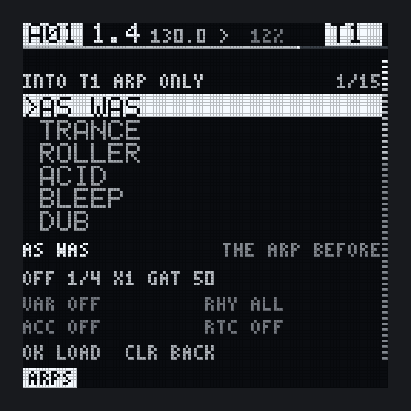</p>

**OK on the ARP page opens ARPS**, fourteen ready-made arps that set all eight at once, on any
machine. It works as SOUNDS does (below): UP/DOWN to move, OK loads with the beat playing, AS WAS
puts back the arp the track had, CLR goes back. TRANCE, ROLLER (U/D with a gallop), ACID (the
3-3-2 accent), BLEEP (random, Euclidean, the odd ratchet), DUB (held 1/8 on the tresillo), OFFBT
(offbeat 8ths: one note on a bass track is the offbeat bass), THUMB, PINKY, CONVRG (triplets
closing in), RATCHT, FILL (a roll at the end of each bar), EUCLID, AMBNT (slow quarters over four
octaves) and DRIFT (sparse random triplets).

### Held notes: the ENV page

<p>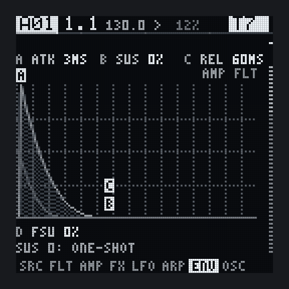</p>

On the VA, WAVE and FM4 machines a seventh EDIT page, **ENV**, after ARP, decides how a note is
held. With it, the POLY machines play pads and long chords, and the MONO ones long bass notes and
drones:

- **A, ATK**: the attack, `3MS` (snappy) up to `5.0S` (a slow swell). Above 0 the
  filter envelope swells with it.
- **B, SUS**: the sustain level, `0%` to `100%` of the note's peak. **At 0% a note is a one-shot**:
  it falls over DEC and ends. **Above 0%** it falls over DEC to SUS and
  **holds there**: for as long as you hold the pad in KEYS (or the MIDI note), or the
  track's own pad in any other mode, or for the step's **LEN** on the sequencer.
- **C, REL**: the release, the tail after the key comes up or LEN ends, `60MS` to `8.0S`.
- **D, FSU**: filter sustain. At 0% the filter envelope sweeps up and closes again over DEC, the
  acid shape; turned up, the filter stays open while the note holds, so a long pad does not go
  dull.

The page draws the whole note: the amplitude envelope and, dimmer, the filter's (`AMP FLT`).
The footer says `SUS 0: ONE-SHOT` or `HOLDS: PAD OR LEN`. On any other machine the page shows
`NOT ON THIS MACHINE`.

A scene captured with SCENE stores the ENV page too, like every other knob. So if a note still
fades with SUS up, look at the morph: a scene stored at SUS 0 pulls SUS down as VALUE moves
towards it. Capture the scene again, or clear its ENV knobs.

**A pad in three moves:** on the PLY track, ENV page: SUS to about 70%, ATK to about `400MS`, REL
to about `2.0S`. Then on the step page give a chord step a LEN of `16 STP`: it holds for the whole
bar and fades into the next. Or queue **A05 PAD** to hear one ready-made.

A05's pad is in the pattern's **locks**, not the kit, so A01-A04's chord stab stays as it is:
each of its four chords locks ATK `400MS`, SUS 70%, REL `2.0S`, a longer DEC, more DET, a darker
CUT, a lower LVL and more reverb. A turned knob on a locked parameter is heard until the next
chord; to make a change stick, clear that lock on the four chord steps (hold the step, push the
knob), and the kit's value takes over. The reverb is in ROOM mode for the whole factory project;
switch it to HALL (MIXER, `REV+`, A) for the bigger tail the pad was made for.

On the MONO machines, LEN only counts once SUS is above 0, so a bass line written for decays
keeps them; a **slid** step carries the held note on into the next pitch
rather than letting it go.

Held notes cost CPU for as long as they hold: long chords on the POLY machines reach the shared 12-voice
budget sooner (the quietest note is faded to make room). The four settings lock, scene and macro
like any other parameter, and every track in a project saved before the page existed loads at 0,
which sounds exactly as it did.

### The oscillators and drive: the OSC page

<p>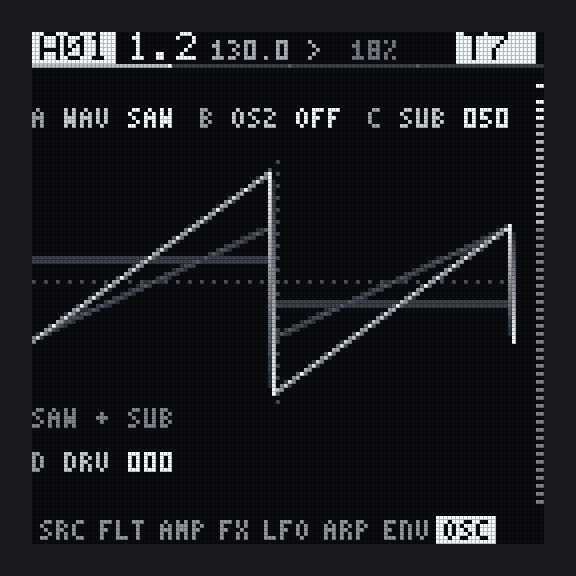</p>

On **VA MONO** and **VA POLY** an eighth EDIT page, **OSC**, after ENV, picks what goes into the
filter (WAVE and FM4 have their own OSC pages, described with them in section 3):

- **A, WAV**: OSC 1's wave. `SAW` from 0 to 31; at 32 a square (`SQR`), hollow and woody;
  turned further the pulse narrows (`P30` ... `P08`), thinner and more nasal.
- **B, OS2**: the second oscillator, in two halves. **0** is off. **1-63** adds a second saw
  **detuned** against the first, shown in cents (`D0` to `D60`): a slow chorus low down, a wide,
  beating Reese bass at the top. The two are spread around the note, so it stays in tune.
  **64-127** is a pulse **hard-synced** to OSC 1 and tuned up from it, `S+0` to `S+24`
  semitones: the bright, tearing formant of a sync lead, and swept with a knob or a lock, the
  classic sync sweep. An accented step brings the synced pulse forward.
- **C, SUB**: the sub oscillator an octave down, from off (0) to heavy (127). The weight under a
  bass; turn it down for leads and plucks that should stay out of the kick's way.
- **D, DRV**: drive into the filter. The oscillators are saturated before the filter and a little
  more after it, so the sound gets thicker and dirtier rather than louder. With RES up, a gritty
  squelch.

The page draws one cycle of the mix that goes into the filter, and says what is in it
(`SAW + SUB DRIVEN`). On any other machine it shows `NOT ON THIS MACHINE`. Like every page, the four lock, scene and macro.

**RES** on SRC runs over the whole knob: each turn adds about the same amount of peak, and from
about 120 the filter whistles by itself at a steady level (self-oscillation; tune it with CUT).
LP24 squelches as hard as LP12. **A thick bass**: OSC SUB up, OS2 about 30 (`D14`), DRV about
40, SRC CUT low and RES under halfway. **An acid line**: SOUNDS, ACID, or by hand: MOD in LP24,
CUT low, RES about 100, ENV up, DEC short, accents on a few steps.

A project saved before the page existed loads `SAW OFF 102 000`: its VAs keep the saw and the sub
but lose the old voice's fixed synced pulse, so they sound a little rounder and darker than they
did. Turn OS2 to 114 (`S+19`) for something close to the old bite.

### Patterns, banks and the project

<p>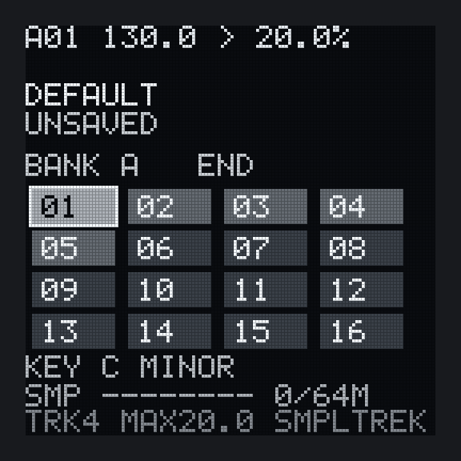</p>

A **pattern** holds all eight tracks: up to 64 steps per track, with their notes, parameter locks
and conditions, plus the pattern's master length, swing, key and scale. Patterns live in
**8 banks (A-H) of 16 slots**, 128 per project. The top line of every screen names the pattern
playing: `A01` is bank A, slot 1.

The **project** is everything: the 128 patterns, the kit (each track's machine, parameters,
level and sample), the tempo, the sends and master, the chain, scenes, macros and mute states.
One project is open at a time.

Each track has its own **length** (1-64 steps) and **speed** (2x, 3/2, 1x, 3/4, 1/2, 1/4, 1/8), so
tracks can run against each other (polymeter). The pattern's **master length** decides when a
queued pattern change lands and when the chain moves on.

### Parameter locks (p-locks)

A **lock** is a parameter value stored on one step. Hold a STEP key and turn A-D: that parameter
of the current page now has its own value on that step, and goes back to the track's value on
the next. A step can hold up to 8 locks, from a pool of 1,024 per pattern. Locks are how a kick
gets one short hit in a bar, or a bass opens its filter on one accented note. STEP LEDs with
locks glow amber.

While you hold the STEP, the screen shows that step: each parameter's value and bar are what the
step plays, and a hollow tick on the bar marks the track's own value, so you see how far the lock
moves it. Turning a knob also writes the change in words, `S5 CUT 64>90`: track value, then lock.
On GRID a trig with locks has a dot in the middle of its cell; a cut top-left corner is a
condition, top-right a probability, two teeth along the bottom a ratchet, and an outline a
trigless step.

Push the knob with the STEP held to take that parameter off the step again (`LOCK CLEARED`): its
lock, its random range and its slide all go.

**Random ranges.** Hold a STEP and **FUNC** and turn A-D: that parameter gets a random range on
the step instead of a fixed value. Each time the step plays, the parameter lands somewhere within
the range either side of the step's lock, or of the track's value when the step has no lock. A
hat whose decay wanders by 20, a snare that never hits the same filter twice. The draw comes from
the pattern's seed and the pass, like probability: the same pass plays the same way after a
reload, and each pass differs from the last. Turned back to 0, the range is gone. The lock line
shows it as `R` and the width (`S5 CUT 64>90 R20`), and a dim line under the bar spans the values
the step can land on. A range takes one of the step's 8 lock slots.

**Parameter slide.** Hold a STEP and **FUNC** and push A-D: that parameter's lock on the step
slides (`SLIDE ON`; again for `SLIDE OFF`). From the step it glides to what the next step that
plays holds for it (that step's lock, or the track's value), arriving as that step starts, so a
filter can sweep between two locked steps with empty steps between them. With no lock yet, the
push locks the track's value first. The lock line ends in `/` while the lock slides. The glide
follows the play mode (REV, PING, RND) and ignores the next step's condition and probability; it
does not glide on a step stutter. It is not the SLID step flag, which bends a VA MONO note into
the next.

### The chain

<p></p>

The **chain** plays patterns in order: up to 64 entries, each a pattern and a repeat count
(X1-X16). It is a list, not a song timeline. You build it on PROJECT's CHAIN page and turn it on
and off with the FUNC menu's CHAIN row (FUNC+HOME). Each entry can also recall a **mute state** as it starts, and
**SONG** mode plays the chain once and stops, so a chain can be a whole arrangement (below).

### Scenes and morphing

<p></p>

A **scene** is a snapshot of parameter values for any tracks. A project has 16. Two of them sit
on the **A** and **B** sides, and in PERFORM the VALUE knob **morphs** the live sound from A to
B. A parameter that only one side stores fades between that side's value and the kit's value, so
a scene that touches only the bass leaves the drums alone. Scenes change the kit values only;
a step's locks still win over the morph.

With VALUE at rest the morph **lets go**, the way a macro at 0 does: the EDIT knobs own the
sound, and scene A takes over from the first click up. So capturing a scene never leaves a knob
dead -- but parking the morph at 0 is not a way to recall scene A either.

### Macros

A **macro** is one knob that moves up to 4 parameters at once, each towards its own target value.
There are four, on encoders A-D in PERFORM. At 0 a macro does nothing, so its parameters still
follow their EDIT knobs and the morph; turned up, it sweeps them from wherever they are. A new
project has three: **B ACID**, **C DUB** and **D DRIVE**. Macro A is left for you, and pressure on
the selected track's pad pushes it up while you lean on it.

### MUTATE

<p></p>

<sub>Right after the press: what was mutated, on which track. Then `OK KEEPS CLR REVERTS` until you answer, with the MUTATE pad lit bright.</sub>

**MUTATE** (upper pad 7) makes a seeded variation of the selected track: rotate it, add or
remove hits, or nudge velocity, timing, probability or notes within the scale. It is one undo
level: OK keeps it, CLR takes it back.

### GEN and EVOLVE

<p>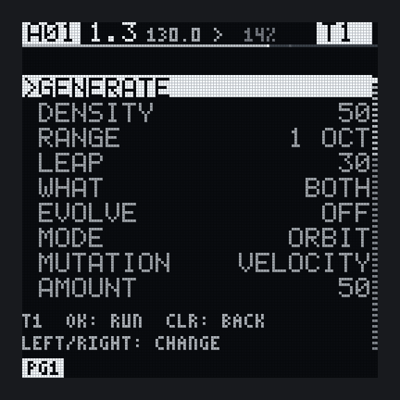</p>

**Hold OK in GRID** (or in KEYS) for the track menu. **GENERATE** writes a new part on the selected track: on
a drum track a rhythm, busier on the beats than between them, with accents and ghost notes; on a
melodic track a line in the pattern's key and scale too, starting on the root. DENSITY sets how
busy, RANGE how many octaves the line may climb, LEAP how often it jumps, and WHAT whether to
replace the rhythm, the notes or both. Every press is a new part and one undo level.

**EVOLVE** makes the track mutate on its own, every 1, 2, 4 or 8 loops, with the mutation and
amount PERFORM's MUTATE uses. In **ORBIT** each change starts again from the part as it was when
EVOLVE went on (its HOME), so it varies around itself and never wanders off; in **DRIFT** the
changes add up. **KEEP** stops it where it is, **HOME** stops it and puts the part back. What you
edit while it runs is kept. **MIX**, the last MUTATION, picks a different mutation every turn
(and on the MUTATE pad every press). EVOLVE is saved with the project: it opens evolving again,
from the part as it was saved.

### Kits

A **kit** is the sound side of a project without the patterns: the eight machines, their 16
parameters each, the faders, the sidechain duck and the sample paths, and each track's settings
that are not knobs: SLC AUTO, LFO TRIG, the two MOD slots, the choke group and the arp's VAR,
RHYTHM, ACCENT and RATCHET. Besides the project's own kit there is a
**kit library** of 16 slots on the card, shared by every project, so a sound you built in one
project can be recalled in another (KIT mode, `FUNC+EDIT` twice).

For one track rather than eight there are the **factory sounds**: OK in EDIT or MACHINE on a drum
or VA track lists ready-made sounds for its machine and loads one into that track only (section 3,
[Factory sounds](#factory-sounds-one-track-at-a-time)).

### On the card

Everything STRATA keeps is on the SD card, never in the unit's flash. (To put STRATA on a card
in the first place, [strata.einblick.dev](https://strata.einblick.dev) builds the card zip for
you, with starter projects, a sample pack and a quick start unless you untick them;
[INSTALL.md](INSTALL.md) has the steps.)

```text
/ENAGA/APPS/STRATA/APP.ENA                     the app
/ENAGA/DATA/STRATA/SETTINGS.TXT                which project was open last, counters
/ENAGA/DATA/STRATA/PROJECTS/<NAME>/PROJECT.BIN tempo, sends, master, chain, mute states
                                  /KIT.BIN     machines, parameters, faders, sample paths
                                  /PERFORM.BIN scenes and macros
                                  /BANK_A.BIN ... BANK_H.BIN   16 patterns each
/ENAGA/DATA/STRATA/AUTOSAVE/                   the working copy, same files
/ENAGA/DATA/STRATA/KITS/KIT_01.BIN ... KIT_16.BIN   the kit library
/RECORD/STRATA_<n>.WAV                         resampled takes
/RECORD/JAM_<n>.WAV                            JAM REC recordings
/SAMPLES/STRATA/                               the starter sample pack, if the card builder added it
```

The first project is called `DEFAULT`. A new project is named `NEW1`, `NEW2` and so on. Give a
project its own name with SAVE AS and pick another one on the PROJECTS page (section 6). STRATA
reopens whichever was open last.

---

## 2. Your first beat

This walks through the factory demo project, which is what a first start plays and what the
FUNC menu's LOAD DEMO brings back (a NEW PROJECT starts empty). It takes about fifteen minutes.

**What is in it.** Bank A holds five patterns in C minor at 130 BPM:

| Slot | Name | What it is |
| --- | --- | --- |
| A01 | GROOVE | Four on the floor, backbeat clap, 16th hats with offbeat opens, a rolling bass, a dub chord stab, a rim and a few loop slices |
| A02 | GROOVE+ | The same beat developing: a kick pickup every fourth bar, a hat roll, a clap on FILL, a 12-step perc line and a 7-step loop against the 16 |
| A03 | BREAK | Kick and bass out; long dub chords, a perc ticking at 35% probability |
| A04 | PEAK | Everything up: ratcheted hats, an acid bass line, a rave stab, kick and clap rolls on FILL |
| A05 | PAD | Held chords over a quiet beat: Cm9, Abmaj7, Ebmaj7 and Gm7, a bar each, swelling in and ringing into the next. The sound of the [ENV page](#held-notes-the-env-page) |

It also ships a chain (GROOVE x2, GROOVE+ x2, BREAK, PEAK x2, GROOVE+, about two minutes) that
starts **off**, eight mute states, and scenes 2-4: **DUB** (chord, rim, loop and clap pushed into
the sends), **DARK** (filters closed) and **TENSION** (the bass opens and screams). Scene 1 is
empty, so the morph starts from the kit as it is. Three macros are set up: **B ACID** (the bass
filter), **C DUB** (the chord and rim into the sends) and **D DRIVE** (the kick and hats). Track 8 plays a built-in placeholder of eight
short blips until you give it a sample (section 6).

### 1. Play it

Press **PLAY**. A01 starts; the top line reads `A01 1.1 130.0 > 20%` (pattern, bar.beat, tempo, `>`
playing, audio load) with the selected track's badge at the right, a thin line under it runs
across the pattern, the tabs along the bottom are the screen's pages, and the column at the right
edge is the master level. Turn **VALUE** to change the tempo; push and turn VALUE for swing. **STOP** stops
and lets tails ring; STOP again cuts them.

### 2. Edit steps

<p>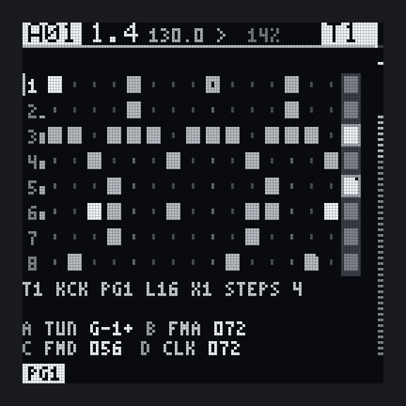</p>

<sub>GRID: one row per track with its number and level, the playhead's column lit; under it the selected track (`T1`), its step page, length and speed, and the four knobs of the current EDIT page.</sub>

Press **HOME** for GRID: all eight tracks as rows, the selected one highlighted. Tap lower pad 2
to select the clap. Its steps show on the STEP LEDs; tap **STEP 8** to add a clap, tap it again to
remove it. The pad-row keys (or LEFT/RIGHT) move between the four 16-step pages of a 64-step track; `L16` on screen
is the track's length.

Clear the whole track with **CLR**, and get it back with **FUNC+CLR** (undo). FUNC+OK is redo.
There are 16 levels.

To start from an empty pattern, clear all eight tracks at once: **FUNC+HOME**, DOWN to **CLEAR
PATTERN**, then **OK** twice within 2 seconds (`OK AGAIN TO CLEAR`, then `CLEARED FUNC+CLR UNDO`).
Every trig and lock goes; the sounds, and each track's length, speed and swing, stay. FUNC+CLR
brings the whole pattern back in one undo.

### 3. Lock a parameter

Select the kick (lower pad 1) and press **EDIT**. The screen keys (or LEFT/RIGHT) flip the
pages SRC, FLTR, AMP, FX; go to **AMP**. Now hold **STEP 13** and turn **A** (DEC) down: the last
kick of the bar is shorter. That is a lock. GROOVE already has one on step 9; hold STEP 9 and push
**A** to remove it (`LOCK CLEARED`). Hold STEP 13 and **FUNC** and turn **A** up a little: now
that kick's decay is different every bar, a random range (`R` on the lock line).

The encoders work the same way in GRID: they edit the current EDIT page of the selected track.

### 4. Change a note, open the step page

<p></p>

Select the bass (pad 6). Hold a STEP that has a note and turn **VALUE**: that changes the step's
note. Hold the STEP and press **OK** to open the **step page**: A-D edit NOTE, VEL, LEN, MICR;
the screen keys flip to PROB, COND, RTCH, RAMP and then ACNT, SLID, CHRD. LEFT/RIGHT walk to
the neighbouring steps. Turn SLID on for a 303-style slide into the next note. OK or CLR closes
it. The page answers A-D whether or not you are still holding the STEP.

**A note's length from the STEP keys:** hold the STEP with the note and press a later STEP. The
screen says `LEN 4 STP` (or whatever reaches that far), and when you let go the note lasts up to
the end of the step you pressed. The table has 1, 1.5, 2, 3, 4, 6, 8, 12, 16 ... 64 steps, so a
span between two of them takes the shorter one: the note never runs past the key you pressed. The
pair is still a range (`SEL 1-5`): press CLR, copy or turn A/B while holding and it is only a
range, with no length set; copy or transpose it later and the old LEN goes back first. With SUS up
on a VA this is how a held pad is written in.

### 5. Play it in

<p></p>

Press **HOME twice quickly** for KEYS. The two pad rows become a piano keyboard: the lower pads
are the white keys C to C, the upper pads above them the black keys (C#, D#, F#, G#, A#), and the
two upper pads with no black key are octave down (between E and F) and octave up (after B). Pads
play at the strength you hit them and hold the note while down; the pads in the scale light in
the track's colour, the root brightest; the screen draws the same keyboard. LEFT/RIGHT change
octave, UP/DOWN the track, and FUNC + a pad still mutes on the bar. **Hold OK** for the track menu
(GENERATE and EVOLVE, below), as in GRID; the pads stay the piano while it is open. The STEP keys are the track's
steps, as on GRID, with the pad-row keys for the step page, so you can play a line on the pads and
place or fix steps at the same time. Press **REC** (it lights red) while playing and what you play is
recorded onto the selected track, quantized by the SETUP page's QUANTIZE amount (100% by
default). Pads record too, with their velocity. REC again stops. Turning A-D while recording
writes locks onto the steps as they pass (motion recording).

### 6. Change pattern

Press **PROJECT**. The 16 slots of bank A are on screen and on the STEP keys. Press **STEP 2**:
`A02 END` shows, and GROOVE+ takes over at the end of the current pattern. Encoder **A** picks when
a change lands: END, after 16 or 32 steps, or NOW. Go on to A03 and A04. In PEAK, hold the
**FILL** pad (upper pad 1) for the last bar to hear the kick and clap rolls.

To let STRATA play the arrangement itself, press **FUNC+HOME**, scroll to CHAIN and press OK
(`CHAIN ON`), then CLR to close the menu.
**FUNC+STOP** stops and resets everything, and puts a running chain back to its first entry.

### 7. Perform

<p>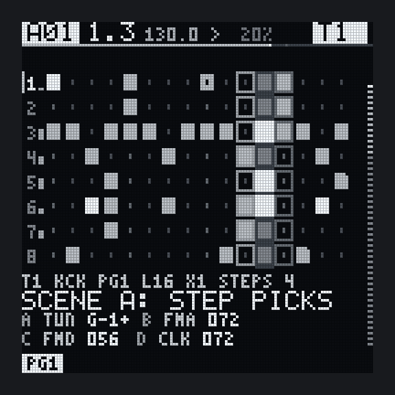</p>

<sub>Every performance pad names itself when pressed: here SCENE A, held.</sub>

Back in A01, press **FUNC+MIXER** for PERFORM. Turn **VALUE**: the bar at the top moves from
scene A (1, empty) to scene B (2, DUB), and the groove fades into a dub version of itself. Hold
the **SCENE B** pad (upper pad 5) and press **STEP 3** to put DARK on the B side instead, or
STEP 4 for TENSION.

Still in PERFORM, turn **B** up slowly: ACID opens the bass filter, adds resonance and filter
envelope. **C** pushes the chord and the rim into the delay and reverb, **D** lengthens and drives
the kick and lets the hats ring. Turn a macro back to 0 and the sound is exactly where it was.

Then try the rest of the upper row, in any mode:

- **FUNC + lower pad 1** mutes the kick on the next bar; again unmutes it.
- **MUTE** pad (upper 3), then **STEP 2**: recalls mute state 2, the kick-less breakdown.
  STEP 1 brings everything back. MUTE again returns the pads to playing.
- Select the rim (pad 5) and hold **THROW** (upper 6): the rim goes fully into the delay while
  held. FUNC + THROW throws into the reverb.
- Hold **REPEAT** (upper 2) for a beat repeat of the master; turn VALUE while holding it to pick
  1/4 to 1/16T.
- Select the bass and tap **MUTATE** (upper 7). Like it: OK. Don't: CLR.
- Hold **FUNC** and push encoder **A**: the lows are gone (`KILL LOW`). Push FUNC+A again on the
  one and they slam back (`LOW BACK`). FUNC+B and FUNC+C do the same for the mids and the highs.

### 8. Save

Press **FUNC+HOME** (the FUNC menu opens on SAVE), then **OK** (`SAVING`). The PROJECT screen
stops saying `UNSAVED`. STRATA also autosaves whenever the transport stops.

---

## 3. The machines

Each machine uses the SRC and AMP pages; FLTR and FX are the insert chain (section 1). On every
machine, AMP's first knob is the decay and its last is LVL, the output level (square law, so
the quiet end has room). Where a machine follows the trig note, note 60 (C4) plays the knob's own
pitch and other notes transpose from there.

**TUN as a note.** TUN (PIT on SAMPLE and GRAIN) shows that pitch as a note: where TUN puts C4,
spelled as on the step page (`C-4`, `F#2`). On a drum that is the drum's pitch: KICK at 64 reads
`A-1` (55 Hz). On a melodic machine it is the transposition: VA MONO at 64 reads `C-4` (none), an
octave up `C-5`. In this NOTE view a knob click moves TUN one
semitone, to the setting closest to that note, so tuning a kick or a tom to the key is a few
clicks. TUN has 128 settings across its range, so not every note falls exactly on one: a `+` or
`-` after the note means the setting is 5 cents or more sharp or flat of it (VA MONO's fifth,
`G-4+`, is 12.5 cents sharp). For SAMPLE and GRAIN the name assumes the sample itself is a C.
**Push the TUN knob** (on EDIT, GRID or KEYS) to see the number 0-127 instead and turn it a count at
a time, for tuning between notes; push again for notes. NOTE view is on at every start and
applies to every track. Locks follow it: hold a STEP and turn TUN in NOTE view, and the lock
moves in semitones.

The drum machines (KICK, SNARE, HAT) follow Mutable Instruments Plaits' models, reimplemented;
docs/SOUND.md has the details.

### KCK: KICK

A 909-style kick: an oscillator with a pitch sweep, a click, and a body that goes from sine to
distorted. Two voices, so a ratchet does not cut itself off.

| Page | A | B | C | D |
| --- | --- | --- | --- | --- |
| SRC | **TUN** pitch, 25-120 Hz (55 Hz at 64) | **FMA** pitch-sweep amount, up to about +26 semitones | **FMD** sweep time, 8-128 ms | **CLK** click level |
| AMP | **DEC** decay, 20-640 ms time constant | **TON** body low-pass: thud to open | **DRT** dirt: clean sine to soft-clipped | **LVL** |

The trig note transposes the kick, so a kick follows the key. FMD in the middle of the knob is
where the classic click lives. Add DRV on FLTR for more 909 grit.

### SNR: SNARE

A 909-style snare: a tuned pair under filtered noise, with a clap mode. Two voices.

| Page | A | B | C | D |
| --- | --- | --- | --- | --- |
| SRC | **TUN** 90-439 Hz (200 Hz at 64) | **SNP** snappy: body to noise | **TON** noise band, ±2 octaves | **CLP** clap: under 43 off, 43-84 three bursts, 85+ four |
| AMP | **DEC** decay | **SPR** clap spread, 2-40 ms between bursts | **BDY** longer body tail | **LVL** |

The factory clap is CLP 64 with SNP high and SPR around 10 ms.

### HAT

The 808 recipe: six square oscillators through a band-pass, plus optional noise. Two voices.
**Track 3 chokes track 4**: a hit on track 3 cuts track 4's ring short, which is how a closed hat
closes an open one.

| Page | A | B | C | D |
| --- | --- | --- | --- | --- |
| SRC | **TUN** 180-940 Hz | **TON** band-pass, 150 Hz-9.6 kHz | **NOI** squares to noise | **DTN** detune: near unison, 808 (64), clangy |
| AMP | **DEC** decay, 7 ms-0.9 s | **CHO** how fast a choke cuts it, 2-120 ms | **CHK** choke group, 0-4 (shown; the choke itself is track 3 onto track 4) | **LVL** |

### PRC: PERC

Two-operator FM percussion: rims, toms, cowbells and blips. Two voices.

| Page | A | B | C | D |
| --- | --- | --- | --- | --- |
| SRC | **TUN** carrier, 48-1822 Hz (300 Hz at 64) | **RAT** ratio: lower half steps through 16 useful ratios, upper half sweeps 4-16 | **IDX** FM depth: brightness | **IDD** how fast the brightness falls |
| AMP | **DEC** decay, 4-600 ms | **SWP** pitch sweep, up to +36 semitones | **SWT** sweep time, 1-200 ms | **LVL** |

Rough guide: toms around TUN 20-45 with a whole-number RAT and some SWP; rims and cowbells around
TUN 70-90 with an odd RAT; blips at TUN 100+ with high IDX and short IDD. Velocity also brightens
a hit.

### SMP: SAMPLE

Plays a sample from RAM, whole or in slices. Four voices.

| Page | A | B | C | D |
| --- | --- | --- | --- | --- |
| SRC | **PIT** ±24 semitones (unity at 64) | **STA** start | **LEN** length of what is left after STA (127 = to the end) | **SLC** slices, 1-16 |
| AMP | **ATK** attack (0 = none) | **DEC** decay, 5 ms-16 s; 127 = hold | **PLY** forward, forward loop, reverse, reverse loop (four zones of 32) | **LVL** |
| ENV | `---` (ATK is on AMP) | **SUS** sustain: 0 leaves DEC in charge; up holds the sample (a looped one becomes a pad) for the step's LEN or while its pad is held | **REL** release, 30 ms (a declick) to 8 s | `---` |

With **SLC 1** the sample is one-shot and the trig note transposes it. With **SLC 2-16** the
window is cut into equal slices and the **note picks the slice**: C4 (60) is slice 1, C#4 slice
2, and so on, so a chopped loop lies across the notes in order. The factory LOOP track uses 8
slices. Loop modes repeat the window or the slice.

**SLC AUTO.** Equal slices only fit a loop whose hits sit on an even grid. A played break does
not, so its slices start before or after the hit they were meant to hold. Push **D** (the SLC
knob) on the SRC page to turn **AUTO** on: SLC then cuts at the hits STRATA found in the sample
when it loaded, instead of evenly. SLC still sets how many slices: at SLC 8 the window is cut at
its 7 strongest hits, in order. The footer says `SLC AUTO: 12 HITS` (up to 15 are
found per sample), and with fewer hits inside the STA/LEN window there are fewer slices. With no
hit in the window (`NO HITS`, or a window between two hits), it cuts evenly. Push D
again for even slices (`SLICES EVEN`). AUTO is saved with the kit. A streamed file has no
slices either way.

**The waveform.** The SRC page draws the sample across the screen: the STA..LEN window bright with
a line at each end, the rest dim, a dotted line at each slice (even or AUTO), and a column
running through it for each voice that plays. A track with no file shows the placeholder it plays
and says `NO FILE`. A streamed file shows the part that is in memory, then a dotted line. The
AMP page draws the envelope ATK and DEC make, with the letters A and B on its corners and a
hollow square riding it while a note plays. The sample browser (SAMPLES) shows the waveform of
what the track plays above its `NOW` line.

<p>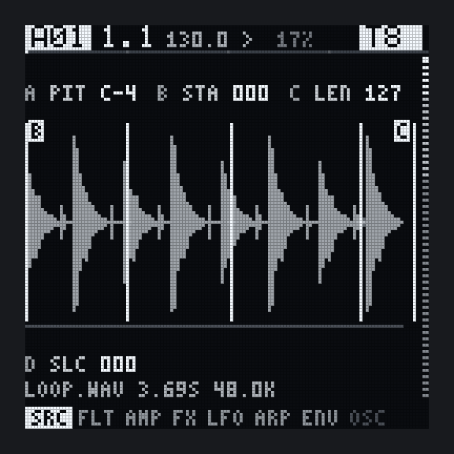 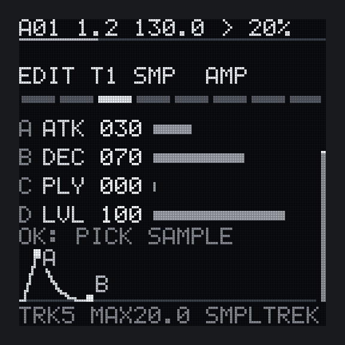</p>

### GRN: GRAIN

Granular playback of the track's sample: up to 8 overlapping grains in one voice. The most
expensive machine (section 7). Every knob shows its unit on screen: milliseconds, `X2.5` for
grains in the air, `HOLD`, a share in `%`.

| Page | A | B | C | D |
| --- | --- | --- | --- | --- |
| SRC | **POS** position in the sample | **SIZ** grain size, 8-680 ms | **DEN** grains in the air, X0.3-X8.0: under X1 leaves gaps (a stutter), X2 and up is a smooth cloud | **SPR** spray, 0-500 ms: chorus, cloud, wash |
| AMP | **DEC** 5 ms-15 s; 127 = `HOLD` | **PIT** ±24 whole semitones | **SHP** grain shape: smooth to plucked | **LVL** |
| ENV | **ATK** attack, 0 (none) to 5 s | **SUS** sustain: 0 leaves DEC in charge; up holds the cloud while a KEYS pad or the step's LEN lasts | **REL** release, 180 ms-10 s | |
| OSC | **SCN** scan: the read head moves from POS while the note sounds, `OFF` to 200% of real time (100% at 90) | **PSP** pitch spray: 1-63 detunes each grain by up to a semitone (`D25`), 64-127 sends up to half the grains an octave up (`OCT25`, a shimmer) | | |

**Where to start:** press **OK** in EDIT for the GRN SOUNDS list (below), or switch a track to GRN,
which loads CLOUD. Then turn POS to the part of the sample you want. Rough guide: SIZ around 75 ms
and DEN X3 or more for a cloud, SIZ 250 ms and up with little SPR for a pad or a freeze, DEN under
X1 with SHP up for stutters and chops, SCN for a stretch.

SCN is free-running, not tempo-locked. To make a cloud move in time, **lock POS on steps**, or
motion record a sweep of POS. The trig note transposes, so a cloud plays chromatically.

**The cloud on screen.** The SRC page draws the sample with a bracket where the next grain
starts (POS, moving with SCN, as wide as one grain) and a tick for every grain in the air, as
bright as that grain is loud. AMP and ENV draw the cloud's envelope.

<p>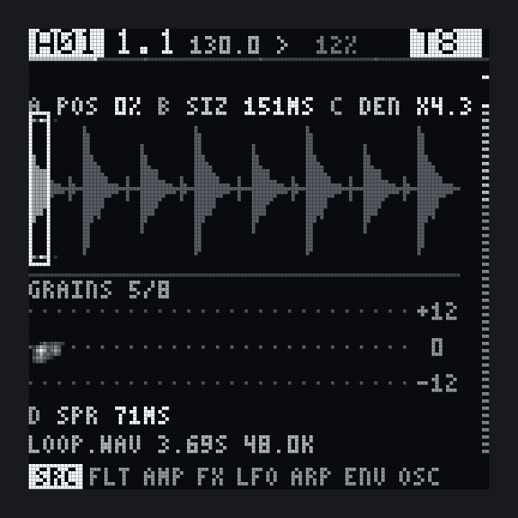</p>

### MNO: VA MONO

The bass and lead voice: a saw or pulse, a second oscillator (detuned or hard-synced), a sub an
octave down and a little noise, driven into its own resonant filter with an envelope. One voice,
with accent, slide and glide.

| Page | A | B | C | D |
| --- | --- | --- | --- | --- |
| SRC | **TUN** ±24 semitones | **MOD** voice filter: 0-63 LP24, 64-95 LP12, 96-111 BP12, 112-127 HP12 | **TON** tone: 64 flat, lower darker, higher thinner | |
| FLTR | **CUT** cutoff, 35 Hz-12 kHz | **RES** resonance | **ENV** filter envelope amount, up to +66 semitones | **FDE** filter decay: 0 follows DEC (0.55 x DEC), 1-127 its own, 15 ms-2.4 s |
| AMP | **DEC** decay, 15 ms-2.4 s | | **GLD** glide, 0-0.5 s | **LVL** |
| ENV | **ATK** attack | **SUS** sustain: 0 = one-shot | **REL** release | **FSU** filter sustain |
| OSC | **WAV** saw, square, pulse | **OS2** off, 1-63 detune, 64-127 sync | **SUB** sub level | **DRV** drive |

With SUS at 0 (the default) DEC is the note's length. Turn SUS up for long, held notes: see
[Held notes: the ENV page](#held-notes-the-env-page).

FLTR is the voice's own filter, the only one on the track (TON on SRC is a tone knob after
it). ENV 0 is a static dub bass; ENV and RES up is the acid squelch; RES at the top
self-oscillates. FDE at 0 keeps the classic tie, the sweep 0.55 x DEC long; turn it up for a
short squelch on a long note or a slow bloom on a pluck. **Velocity** opens the filter: around
the default 100, harder is brighter and softer darker. **Accent** (ACNT on the step page) makes
the note louder, opens the filter further and brings the noise (and, with OS2 in sync, the synced pulse) forward; **slide** (SLID)
glides into the next note. The OSC page is described in
[The oscillators and drive](#the-oscillators-and-drive-the-osc-page).

FLTR draws the filter: its response at CUT and RES (`LP24`, `LP12` at the right) over the
spectrum of what the track plays, with the footer's `ENV>CUT +37` saying how far ENV opens it.
AMP draws the note's envelope, ENV the whole note with the filter's envelope beside it. A
segment's width follows its knob, so a long and a short decay both fit the screen.

<p>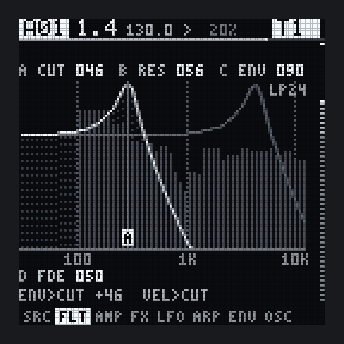</p>

### PLY: VA POLY

The same voice as VA MONO, up to six notes at once, for chords. Each step can play a chord
(CHRD on the step page: MIN, MAJ, SUS2, SUS4, DIM, MIN7, DOM7, MAJ7, MIN9, MIN11, 5TH, OCT, 5TH OCT,
each with inversions `/n`).

| Page | A | B | C | D |
| --- | --- | --- | --- | --- |
| SRC | **TUN** | **MOD** as MNO | **TON** as MNO | |
| FLTR | **CUT** | **RES** | **ENV** | **FDE** as MNO |
| AMP | **DEC** with SUS at 0, the chord's length: short stab or long ring | | **DET** voice detune, up to a quarter semitone | **LVL** |
| ENV | **ATK** attack | **SUS** sustain: 0 = one-shot | **REL** release | **FSU** filter sustain |
| OSC | **WAV** | **OS2** as MNO | **SUB** | **DRV** |

For pads, turn SUS up on the ENV page: a chord then holds for its step's LEN, or for as long as you
hold the keys ([Held notes: the ENV page](#held-notes-the-env-page)).

Every note is a sustaining voice and costs CPU while it rings. All VA POLY, WAVE POLY and FM4 tracks
together share a budget of **12 voices**; past it, the quietest note is faded out quickly to make room. A longer
DEC, a long LEN with SUS up, or a long REL all mean more notes overlap.

### WMN and WPL: WAVE MONO and WAVE POLY

The VA voice with a **wavetable** where its two oscillators were: 16 tables of 16 frames each,
built into STRATA (no files needed), from PolyWerk's recipes. A table is computed the first
time a track plays it, which takes a moment: until then you hear only the sub. POS moves smoothly through a
table's frames; MOT lets the filter envelope move it, so a note's timbre changes as it plays.
Everything else is the VA's: the sub, the 24 dB filter with its envelope, the ENV page, accent,
slide and glide on WMN, chords and the shared 12-voice budget on WPL.

| Page | A | B | C | D |
| --- | --- | --- | --- | --- |
| SRC | **TBL** the table, eight counts each (shown by name) | **POS** position, frame 0-15 | **TON** as MNO | |
| FLTR | **CUT** cutoff, LP24 | **RES** resonance | **ENV** filter envelope amount | **FDE** as MNO |
| AMP | **DEC** as MNO | | **MOT** envelope to position: 64 off, up to +15 or -15 frames | **LVL** |
| ENV | **ATK** | **SUS** | **REL** | **FSU** as MNO |
| OSC | **WRP** bends the cycle (0 = none; high notes bend less, to stay clean) | **DET** a second, detuned copy: OFF, up to 60 cents | **SUB** sub level | WMN: **GLD** glide; WPL: **DRV** drive |

The tables, from TBL 0 up:

| TBL | Table | From frame 0 to 15 |
| --- | --- | --- |
| CLS | CLASSIC | sine, triangle, saw, square |
| PWM | PWM | a square narrowing to a thin pulse |
| SYN | SYNC | a hard-synced saw, the sync ratio rising |
| FMT | FORMANT | a vocal formant sweeping up |
| RSW | RESO SAW | a saw with a resonant peak sweeping up: a filter sweep with no filter |
| HRM | HARMONICS | organ-like, more harmonics drawn in |
| FLD | FOLD | a sine wavefolded harder and harder |
| PHD | PHASE DIST | CZ-style phase distortion, soft to sharp |
| FM1 | FM RATIO | two-operator FM, the index rising |
| TIN | FM TINE | an electric piano's tine: a sine gaining its metallic partials |
| DGT | DIGITAL | eight stepped digital spectra |
| VOW | VOWELS | "oo" to "ah" to "ee" |
| GRL | GROWL | a bass growl, darker to snarling |
| EPN | E-PIANO | mellow to barking |
| PLK | PLUCK | a plucked string, bright to dull (and quieter as it dulls) |
| MLT | MALLET | soft mallet, marimba, vibraphone, xylophone, glockenspiel, kalimba |

MOT above 64 moves the position up as the filter envelope rises and back as it falls; below 64 it
moves it down. With PLK at POS 127 and MOT 0, each note starts bright and dulls like a string.
The SOUNDS list (OK on MACHINE) has 8 WMN and 7 WPL starting points.

### FM4: four-operator FM

Four sine operators in the eight classic 4-operator algorithms: e-pianos, bells, glass, brass,
organs and FM basses. Six voices with chords, like PLY, in the same shared 12-voice budget. The
operators come in two pairs so it stays dialable: the carriers sit at **CAR**, the modulators at
**RAT** (plus **FIN**), and **DET** pulls the second of each pair sharp. **IDX** is how bright
the tone is; the index has its own envelope, faster than the volume's, so a note strikes bright
and mellows as it rings (**IEN** says how much).

| Page | A | B | C | D |
| --- | --- | --- | --- | --- |
| SRC | **ALG** algorithm `A1`-`A8` | **RAT** modulator ratio: 0.5 1 2 3 3.5 4 7 14 | **IDX** FM index (brightness) | **FBK** operator 4 feeding back on itself: a saw-like buzz, to noise |
| AMP | **DEC** decay, 15 ms to 8 s | **IEN** how much of IDX the index envelope moves (0 = a fixed timbre) | **VEL** velocity to index: harder is brighter | **LVL** |
| ENV | **ATK** | **SUS** (0 = one-shot) | **REL** | **ISU** index sustain: where the brightness settles while held |
| OSC | **DET** second pair sharp: `OFF`, up to `D25` cents | **FIN** fine ratio, ±0.5 around RAT (`0` at 64) | **BRT** keytrack: high notes get less index, so they stay sweet | **CAR** carrier ratio: 1, 0.5, 2, 3, 4 |

The algorithms: `A1` one stack 4>3>2>1 (the brightest), `A2` 3 and 4 into 2 into 1, `A3` 3>2>1
with 4 into 1, `A4` 4>3>1 with 2 into 1, `A5` two pairs 2>1 and 4>3 (the e-piano), `A6` 4 into
three carriers, `A7` one pair 4>3 over two plain sines, `A8` four sines (an organ: RAT sets the
second drawbar). The SOUNDS list has EPIANO, BELL, BASS, BRASS, ORGAN, MALLET, PAD and GLASS.
FBK costs a little more CPU than FBK 0.

High notes at high IDX are held back so they stay clean: in a stack the sidebands multiply, and
past a point they would fold back as harsh, out-of-tune tones. The cap looks at the whole chain
of operators, so `A1` at IDX 90 is a little less bright on high notes than its number suggests,
and low notes are not touched.

### MID: MIDI

MID makes no sound of its own. It is for a track whose sound is an outboard synth, a drum
machine or a modular: the track's notes go to MIDI OUT and STRATA spends no voice and no CPU on
them. Give the track a channel first (MACHINE, encoder **B**); MACHINE shows `MIDI OUT OFF` lit
at the top right on a MID track that has none, because then it does nothing at all.

| Page | A | B | C | D |
| --- | --- | --- | --- | --- |
| SRC | **C74** CC 74 (brightness, cutoff) | **C71** CC 71 (resonance) | **C73** CC 73 (attack) | **C72** CC 72 (release) |
| AMP | **C70** CC 70 | **C75** CC 75 | **C76** CC 76 | **C77** CC 77 |

These are the General MIDI 2 sound controllers, which many synths answer without any setup; on
others, MIDI-learn them. A CC is sent when its value **moves** (a knob, a lock, a scene, a macro),
never just because a track became MID, so a synth you set up by hand keeps its sound until you
touch a knob. A step's locked CCs go out just before its note. FLTR and FX do nothing on MID.

MID sends its notes as written, without folding them into the scale (the receiver may be a drum
machine, where a note picks a sound). A step with a chord sends the whole chord.

### MIDI out on any track

Every machine can send, not only MID: give a KCK or PLY track a channel and its notes go to MIDI
OUT as well as sounding, to double a part on a synth. A track sends every note it plays: steps
(with their velocity; an accent sends 127), ratchets, chords (the whole chord, even past the
12-voice budget, which only counts STRATA's own voices), every arp hit and note repeat hit, pad
hits, KEYS and MIDI IN notes.

Every note gets its note-off. A step ends after its LEN (one step if it has none, and so does a
pad hit); a KEYS pad or a MIDI IN note when you let go. Muting the track, changing its channel or
machine, recalling a kit and STOP end its notes at once. The **second STOP** and **FUNC+STOP** also
send All Notes Off on every channel a track uses, for a synth that missed something. Notes leave
within one audio block (1.3 ms) of their step. The channels are saved with the project.

**On Enaga 0.2.0 firmware (STRATA v0.1.0 to v0.3.1), unplug USB while driving gear from the
MIDI OUT jack**, or keep a program on the computer reading the SmplTrek's USB MIDI port: a
computer that is not reading fills the USB queue and stops the DIN jack with it. Enaga 0.3.0,
which builds after v0.3.1 need, fixes this.

### The key and the scale

Each pattern has a key (root) and a scale, set in PROJECT with encoders **B** (key) and **C**
(scale). The melodic machines **fold** their notes into the scale: the VA, WAVE and FM4 machines, GRAIN,
and SAMPLE when it is not sliced (SLC 1). Drums and sliced samples are not folded, since there the
note picks a pitch or a slice rather than a melody. Scales: CHROMATIC, MINOR, MAJOR, DORIAN,
PHRYGIAN, LYDIAN, MIXOLYDIAN, LOCRIAN, HARM MINOR, MEL MINOR, MINOR PENT, MAJOR PENT, BLUES,
WHOLE TONE, DIMINISHED. Notes are named with sharps (D#, not Eb).

TUN is applied **after** the fold: the sequencer folds each note into the key, then the machine
transposes it by TUN. So TUN moves the whole line chromatically, and in NOTE view it steps through
all twelve notes, not just the scale's. Moving a line by a scale step would not keep it in the key
(A minor moved up a whole step is B minor, with C# and F#); only an octave does, which is twelve
clicks. To keep a melodic track in key, leave TUN at `C-4` or an octave of it and write the notes;
on drums, which are not folded, TUN is simply the drum's pitch and can go to any note of the key.

### Changing a track's machine

<p></p>

`FUNC+EDIT` opens MACHINE. The arrows move over the grid of machines (UP/DOWN one, LEFT/RIGHT a
column of three) and encoder A walks it too; you hear the change at once. The title says which
track you are changing (`MACHINE T1`). To change another track, press its pad or use the screen
keys, which say `TRACK 2` and so on. Encoder **B** sets the track's MIDI
OUT channel: OFF, or 1-16. `FUNC+EDIT` again opens the kit library (section 6).

### Factory sounds: one track at a time

<p>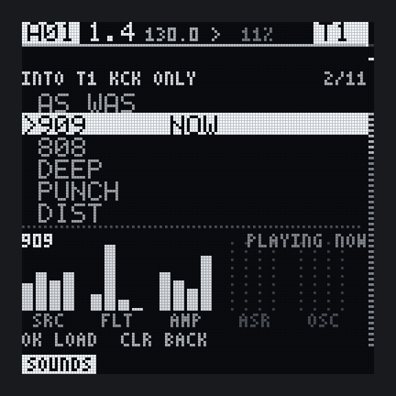</p>

Every drum machine, both VAs, both WAVE machines, FM4 and GRAIN come with a short list of ready-made sounds.
On a KCK, SNR, HAT, PRC, MNO, PLY, WMN, WPL or FM4 track, press **OK** in EDIT or MACHINE: **SOUNDS** lists them.
On a GRN track it is **OK in EDIT** (OK in MACHINE opens the sample browser). UP/DOWN or A move
the cursor, **OK loads** the one under it into this track, with the beat playing, and the list
stays open so the next OK tries the next one. `NOW` marks the sound the track has. The first row,
**AS WAS**, is the track as it sounded when you opened the list: OK on it puts that back, so
trying sounds never loses yours. LEFT/RIGHT or the screen keys move to the next track, which gets
its own AS WAS. CLR goes back.

A factory sound sets the machine's SRC and AMP pages, the insert chain's FLTR page (drive and
filter) and, on the VA, WAVE, FM4 and GRAIN machines, the ENV and OSC pages. It leaves the FX page (lo-fi, pan and both sends), the LFO,
the ARP, the fader, HAT's choke group and GRAIN's POS and PIT alone, so the track keeps its place in the mix and a cloud keeps
reading the part of the sample you chose. The
first entry of each list is the factory kit's own sound.

| Machine | Sounds |
| --- | --- |
| KCK | 909 (the factory kick), 808 (long boom), DEEP (rounder, darker), PUNCH (short, hard, driven), DIST (industrial, distorted), SOFT (dub, no click), RUMBLE (long, dark, dirty: for rumble techno), TIGHT (short, clicky), BOOM (ambient: slow drop, longest tail), HARD (hard techno, fully driven) |
| SNR | CLAP (the factory clap), 909SN, 808SN, CLAP4 (four bursts, wide), RIMSN (a snare rim tick), DIRTY (noisy, driven), SHORT (a tight clap), TIGHT (a short snare), NOISE (a long noise wash), DARK (a dark, driven clap) |
| HAT | CLOSED, OPEN (the factory pair), TIGHT, 808HH (pure squares), SHAKE (a shaker), RIDE (long, clangy), TRASH (noisy, metallic), DARK (a dark closed hat), TICK (shortest), SIZZLE (long, bright, noisy), SHIMMR (a ringing metallic cymbal) |
| PRC | RIM (the factory rim), TOM, COWBEL, BELL, BLIP, CONGA, METAL, CLAVE, ZAP (a falling laser), DUBTOM (low, long, for the delay), CHIME (glassy, ringing), KNOCK (a metallic tick) |
| MNO | ROLL (the factory bass), ACID (squelching 303 line), ACIDSQ (the same on a square), FAT (detuned saws, sub and drive), REESE (wide detuned band-pass), SUB (deep, near-sine), PLUCK, GROWL (band-pass mid bass), GLIDE (portamento), SYNC (sync lead), LEAD (square lead with glide), DRONE (SUS up: holds each note for its LEN), DUBBAS (dub bass: closed, deep, held), RUBBER (the offbeat techno bass) |
| PLY | STAB (the factory stab), PAD (A05's pad), STRING, KEYS, RAVE (best with 5TH OCT chords), PLUCK, BRASS, DUBCHD (darker, longer dub chord), WARM (a warm pad), SWELL (opens as it swells), HOOVER (wide driven rave chord), ORGAN |
| WMN | SWEEP, RESO (a resonant sweep), GROWL, FORMNT (formant), DIGI (digital), VOWEL, WARP, FMBASS (FM bass), ACIDWV (acid on a wavetable), HARMBS (harmonics bass), FOLD (fold lead), TINE (a bell pluck) |
| WPL | PAD, EPIANO (electric piano), BELL, MALLET, PLUCK, CHOIR, PWMPAD (a PWM pad), GLASS (a crystalline pad), DIGPAD (digital pad), RESOPD (a resonant pad), STAB (a warm dub stab), VOXSTB (a vowel stab) |
| FM4 | EPIANO, BELL, BASS, BRASS, ORGAN, MALLET, PAD, GLASS, BLIP (the bleep), CHIME (1:14, ringing), DUBSTB (a dub stab), DRONE (held, slow index) |
| GRN | CLOUD (where to start), PAD (swells, holds for LEN), FREEZE (one moment held), SHIMMR (a third of the grains an octave up), DRIFT (a slow scan), STRTCH (half speed, own pitch), STUTTR (gapped plucked grains), CHOPS (short percussive grains for POS locks), HAZE (a dense wide wash), GLITCH (sparse sprayed plucks), TAPE (a worn slow scan) |

Most lists are longer than the screen: they scroll as the cursor moves. PAD, STRING, KEYS, BRASS,
FAT, REESE, ACID, SYNC, LEAD and DRONE sustain (the ENV page's SUS is up), so their notes last as long as
each step's LEN: give the steps long LENs, or hear PAD on A05. A loaded sound is a change to the
kit like turning knobs: it is saved with the project, and FUNC+CLR does not undo it (AS WAS does).

---

## 4. The sequencer in depth

### Steps

Tap a STEP for a trig; tap again to remove it. **FUNC + tap** makes a **trigless** step: it plays
no note but its locks still apply, which is how you change a sound mid-note or set up the next
hit. The STEP LEDs show: green = trig, as bright as its velocity (four steps: soft, medium,
loud, accent; an accented step is brightest), blinking = trig with a condition or probability,
amber = trig with locks, red = trigless, bright red = the playhead.

The step page's fields:

| Field | Range | What it does |
| --- | --- | --- |
| NOTE | 0-127 | The note (also: hold STEP + turn VALUE) |
| VEL | 1-127 | Velocity |
| LEN | 1/16 step ... 64 STP | Note length: how long a POLY machine holds, a MONO one too once SUS is up (the ENV page), and the MIDI note-off |
| MICR | ±11 ticks | Micro-timing: 24 ticks is one 16th |
| PROB | 0-100% | Chance the step plays |
| COND | see below | Trig condition |
| RTCH | 1-8, ROLL/64 ... ROLL/4 | Ratchet: 1-8 repeats within the step; turned on past 8, a roll at a rate (1/64, 1/48, 1/32, 1/16T, 1/16, 1/8T, 1/8, 1/4) for the step's whole LEN: 1/32 with LEN 16 STP is 32 hits across the bar. RAMP then runs across the whole roll, so UP is a build-up. A new trig on the track ends a roll |
| RAMP | FLAT, UP, DOWN | Ratchet velocity ramp |
| ACNT | on/off | Accent |
| SLID | on/off | Slide (VA MONO) |
| CHRD | 1 NOTE, MIN ... 5TH OCT | Chord (VA POLY) |

### Trig conditions

- `a:b`: plays on pass a of every b (b = 2-8). `1:4` plays on the first of every four passes.
- `FILL` / `NOT FILL`: plays only while FILL is held (or auto-fill is on), or only while it is not.
- `PRE` / `NOT PRE`: follows this track's last condition result, to chain decisions.
- `NEI` / `NOT NEI`: follows the result of the track to the left (track n-1).
- `1ST` / `NOT 1ST`: plays only on the first pass after a pattern change, or never on it.

Conditions and probability are seeded from the pattern, so a pattern plays the same way after a
reload.

**Without the step page:** hold a STEP and press an upper pad. FILL steps the condition through
FILL, NOT FILL and none; MUTE through 1:2, 2:2, 1:4, 4:4 and none; REPEAT the ratchet through 2, 3,
4 and off; MUTATE the probability through 75, 50, 25 and 100%. THROW locks the step's delay send
at full, and again takes the lock off (FUNC + THROW: the reverb send): a throw written into the
pattern, saved and undone like any lock. A toast says where it landed (`STEP 5 PROB 50%`,
`STEP 5 DLY FULL`). The order is the rule: STEP first edits the step, pad first performs
(FILL held, then a STEP, writes a FILL trig). The step page still has every value.

### Ranges, copy and paste

Hold two STEP keys to select the range between them (`SEL a-b`). Then CLR clears it, FUNC+UP
copies it, FUNC+DOWN pastes it, encoder A transposes it and encoder B nudges its micro-timing.
The selection lasts until a single STEP press, another track or another screen.
With nothing held, CLR clears the whole track and FUNC+UP / FUNC+DOWN copy and paste the whole
track. The FUNC menu's CLEAR PATTERN (OK twice) clears every track at once. Hold a STEP and press UP / DOWN to copy / paste one step. Everything goes through undo.

### Length, speed and swing

<p>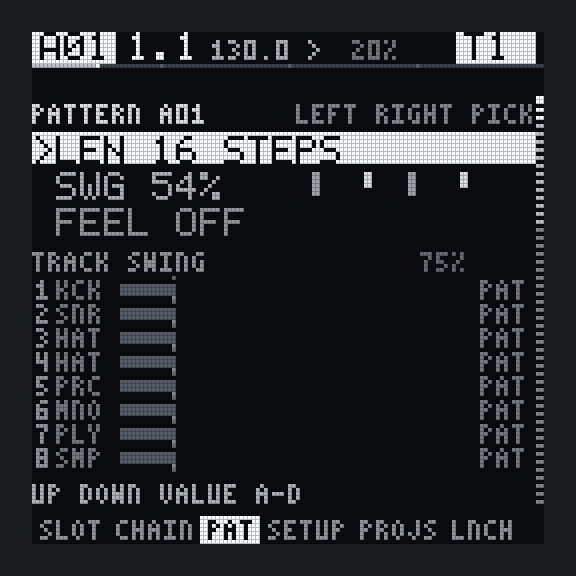</p>

- `FUNC + pad-row keys`: the selected track's length, 1-64 steps.
- The FUNC menu's TRACK SPEED row: its speed, 2x, 3/2, 1x, 3/4, 1/2, 1/4, 1/8 (LEFT/RIGHT).
  **3/2 is 16th-note triplets**: a step every 16 ticks, six to the beat, so a bar is 24 steps.
  Give the track LEN 24 for a one-bar triplet hat, or leave it at 16 for a part that drifts
  against the beat and comes round every two thirds of a bar. 3/4 is the eighth-note triplet.
  Swing still pushes the track's odd steps, on its own 16-tick grid.
- The FUNC menu's TRACK PLAY row, under it: the order the track plays its steps in, without
  changing them. **FWD** as written; **REV** backwards; **PING** forward one pass and backward
  the next (the two end steps sound twice at the turn, so a 16-step track still turns every
  bar); **RND1** a random step in every slot; **RND2, RND4, RND8, RND16** cut the track into
  blocks of that many steps and play a random block in each block's place, its steps in order
  (RND4 swaps beats, RND16 on a 64-step track swaps bars; steps past the last whole block play
  in place). Swing stays on the grid; everything else a step holds (micro-timing, condition,
  probability, ratchet, locks) goes with it. The random order comes from the pattern's seed, so
  the same pattern plays the same bars after STOP and PLAY or a reload, and differs bar to bar.
  Recording under a play mode puts the note on the step playing at that moment. FWD gives the
  pattern back exactly as it was.
- `VALUE push + turn`: the pattern's swing, 50-75%, on the even 16ths.
- PROJECT, screen key RIGHT twice: the **PATTERN** page, where A sets the master length (LEN) and B
  the swing (SWG).
- **Each track can swing on its own**, on the same page: under LEN and SWG are eight TRACK SWING
  fields, `PAT` (follow SWG) or 50-75%. LEFT/RIGHT walk the fields, and C (or VALUE) changes the
  one under `>`; with `>` on LEN or SWG, C sets the selected track's. Hats at 66 over a straight
  kick and bass is the classic use. It is saved with the pattern and undoable.
- **FEEL**, on the same page between SWG and the track swings (D turns it from anywhere on the
  page): a timing drift over the swing and micro-timing, so the pattern stops sitting dead on the
  grid. **DRIFT 1-6** moves each track along its own smooth random curve, a new aim every two
  thirds of a beat, so the parts loosen against each other like players; **WAVE 1-6** moves every
  track together along one slow four-bar curve: on the grid at bar 1, laid back by the end of it,
  on the grid at bar 3, pushed ahead by the end of that, so the groove breathes. The number is the
  most a step moves, in 96ths of a beat (6 is about 29 ms at 130 BPM); it follows the tempo. The
  steps themselves never change, so OFF gives back the grid exactly. The curve comes from the
  pattern's seed and the bar, so it plays the same after STOP and PLAY or a reload. Saved with the
  pattern, undoable, and held by a LOCK.

A 12-step perc against a 16-step kick lands somewhere new each bar for three bars; GROOVE+ does
exactly this.

### Euclidean fill

In GRID, `FUNC + A / B / C` set hits, steps and rotation (`EUC 5/16 R2`), applied live to the
selected track. The steps number is a cycle, not the track's length: 3 in 8 on a 16-step track
plays the 8-step figure twice. Edit the result by hand afterwards.

### Pattern changes and the chain

In PROJECT, the pad-row keys pick the **shown** bank, which is not necessarily
the playing one; STEP 1-16 or the cursor plus OK queue a slot from it. CLR cancels a queued change
(`QUEUE OFF`). The slots show the playing pattern bright, patterns with trigs mid grey, empty ones
dark, and `05>` marks a queued slot.

The **CHAIN** page (PROJECT, screen key RIGHT) lists the entries, `>02 A05 X2 PLAY`. UP/DOWN move the
cursor, a STEP key puts that slot of the shown bank into the entry, LEFT/RIGHT step the entry's
pattern, A or VALUE set its repeats, OK adds a copy after the cursor (up to 64), CLR twice removes
the entry, and the FUNC menu's CHAIN row turns the chain on or off. Chain edits are not undoable.

**Song mode.** B sets the entry's **mute recall**: `--` leaves the mutes alone, `M1`-`M8` recalls
that stored mute state the moment the entry starts (the row reads `>02 A05 X2 M3`). Store an
intro without the kick in state 2 and a breakdown in state 3, point entries at them, and the
chain plays sections rather than just patterns. The FUNC menu's **CHAIN END** row switches the chain between `LOOP`
(round and round) and `SONG`: the chain plays through once, the transport stops at
the end of the last entry (`SONG END`), and the next PLAY starts it again from entry 1. Under an
outside clock that keeps running, STRATA goes quiet at the end and waits for PLAY or the outside
STOP. The header shows which (`CHAIN 3/64 ON SONG`). Both are saved with the project; a project
from before song mode loops, with no recalls.

### Track Launch: one track from another pattern

Play the bass of B07 under the drums of A01 without making a new pattern. Press PROJECT twice
quickly for the **LAUNCH** page: a row for each track with the 16 slots of the shown bank. Pick
the track with UP/DOWN or its lower pad (the pads make no sound here), then press a STEP key:
that track plays the same track's part of that pattern from the next boundary, from its own step
1 (`T3 < B07 AT END`). Hold several lower pads to launch on all of them. CLR sends the track back
to its own part.

A launched track is read only: its steps belong to the other pattern, so edits are refused
(`T3 B07 READ ONLY`). When the mix is right, **hold OK**: CAPTURE writes what plays into the
first empty slot of the bank and switches to it, every track on its own part again, ready to edit.

A pattern change sends every track back to its own part, unless you **pin** it with push B: a
pinned track keeps playing what it plays across pattern changes. Launches are saved with the
project, not in the chain. On GRID a launched track's number is underlined and the info line
says which pattern it plays (`<B07`).

### Recording

REC toggles live and motion recording. With the transport running, pad hits, KEYS and MIDI notes
are recorded with their timing, corrected for the pad's latency and quantized by QUANTIZE (SETUP
page, encoder A, 0-100%; 0 keeps your timing as micro-timing). A hit that cannot be stored where it
was played says `OFF GRID`. One recording pass is one undo level.

**How long you hold a note is recorded too**, on every machine but the drums: when the
pad, key or MIDI note comes up, its step gets the nearest LEN (from `1/16` of a step up to
`64 STP`), so with SUS up a held chord plays back as long as you played it. A drum ignores LEN,
so a drum hit keeps one step. Let go after REC is off, or with the transport stopped, and the step
keeps the length it had.

**Chords are recorded note for note** on VA POLY, WAVE POLY, FM4 and MID. Every note you play
into one step in a pass is kept: the step's note (the first one) plus up to five more, six in all,
which is VA POLY's voices. The step page shows them as `NOTE C4 +2`. They share the step's
velocity (the loudest), its micro-timing and its LEN (the last key up). They play folded into the
key as the rest of a POLY chord does; MID sends them as written unless the step has a chord type.
A seventh note is refused. The extra notes are kept in the step's locks, so a chord of six leaves
two parameter locks free on that step.

What a later pass does is **REC MODE** in the FUNC menu (after QUANTIZE): **REPLACE**, the
default, lets the first note of a new pass take the step over, its old notes and chord type gone,
and the notes played with it join it; **ADD** adds every note to what the step holds, so a chord
can be built up one pass at a time. The edit line says `REC+` under ADD. Transposing a range,
MUTATE's note moves and turning NOTE move the whole chord. VA MONO, WAVE MONO, SAMPLE, GRAIN and
the drums keep one note a step: the last one played.

<p>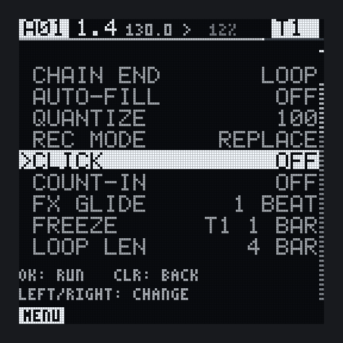</p>

**CLICK and COUNT-IN** (FUNC menu). CLICK `ON` clicks every beat while the transport runs, a
higher click on each bar's first beat. COUNT-IN `1 BAR` or `2 BAR` makes a PLAY from stop with REC
on click that many bars first (the notice counts `COUNT-IN 4` .. `1`), whether CLICK is on or not;
the pattern then starts on step 1 on the next beat, and nothing is recorded during the clicks
(a hit up to half a step before the last click ends is the downbeat played early: step 1).
STOP ends a count-in. The click goes straight to the output: it is never recorded, resampled,
looped or repeated. Neither setting is saved. Under an outside clock there is no count-in (STRATA
does not start the transport then), and with CLOCK OUT on an outboard box starts when the count-in
does, so it runs that many bars ahead.

### MIDI in

MIDI IN (the DIN jack, or USB MIDI) plays STRATA like the pads:

- **Notes**: channels 1-8 play tracks 1-8; other channels play the selected track. A note is held
  until its note-off, so a pad or a chord on a VA, WAVE, FM4 or SAMPLE track sustains under your finger, and
  it is let go on the track it started on even if you have selected another one since. Notes are
  recorded like pad hits while REC is on.
- **CC 16-31** set the track's sixteen parameters in page order: 16-19 SRC, 20-23 FLTR, 24-27
  AMP, 28-31 FX. They change the kit, as turning the knob would (they are not motion-recorded).
- **CC 120 and 123** (All Sound Off, All Notes Off) let go of every note MIDI IN is holding on
  that channel. Enaga sends 123 by itself when a keyboard's active sensing stops.
- **Program change** on your MIDI CH (the Enaga menu, SETUP shows it) queues pattern 1-128,
  which is A01 to H16, in the queue mode PROJECT has set, exactly as pressing the slot would.

---

## 5. Performing

The seven upper pads are the same in every mode:

| Pad | Plain | With FUNC |
| --- | --- | --- |
| 1 FILL | FILL conditions on while held; + tap a STEP: a FILL trig on the selected track | NOTE RPT on/off |
| 2 REPEAT | Beat repeat of the master while held; VALUE or LEFT/RIGHT pick the rate; + hold a STEP: step stutter | Pitch drops as it repeats; FUNC + STEP stutters one track |
| 3 MUTE | MUTE MODE on/off: lower pads mute at once | |
| 4 SCENE A | Hold + STEP 1-16 puts that scene on side A | |
| 5 SCENE B | The same for side B | |
| 6 THROW | Selected track's delay send to full while held | Reverb instead |
| 7 MUTATE | Mutate the selected track; OK keeps, CLR reverts | **LOCK**: held, store; tapped, jump back or swap back (below) |

### Mutes

- `FUNC + lower pad`: mute or unmute that track **on the next bar**.
- In MUTE MODE a lower pad mutes **at once**, and STEP 1-8 are the eight stored **mute states**:
  STEP recalls one at once, FUNC+STEP on the next bar, VALUE pushed + STEP stores the current mutes
  there. The factory states are: 1 everything, 2 no kick, 3 drums only, 4 no hats, 5 no bass,
  6 kick and bass, 7 the melodic parts alone, 8 the bare groove.

Mutes and mute states are saved with the project.

### Scenes and morph

In PERFORM (`FUNC+MIXER`) the top shows `A1 0P` and `B2 9P`: which scene is on each side and how
many parameters it stores, and the morph bar between them. **VALUE** morphs.

- **OK** captures the whole current sound into the scene on side A, including the master kill
  EQ's three knobs (not its kill switches).
- Hold a scene pad + **OK** captures only the selected track into that side's scene.
- Hold a scene pad + **CLR** erases that side's scene.

Because a whole capture holds the kill EQ's knobs, a scene captured with LOW turned down to
`KILL` turns the morph into a slow low-end fade: morph towards it over a build.

A useful habit: leave side A on an empty scene, build a sound, capture it into a scene on side B,
then undo your knob moves and morph back and forth. The morph position itself is not saved.

At rest (VALUE fully down) the morph hands every parameter back to its EDIT knob, so a capture
cannot leave the sound stuck. One click up and side A has it.

### Macros

In PERFORM the four macros sit across the screen: `>A`, `B`, `C`, `D`, each with `---` (empty) or
the number of parameters it drives (`3P`), and a bar showing its position.

**How a macro moves the sound.** Each parameter on a macro has a target value. At **0** the macro
writes nothing: the parameter is wherever its EDIT knob and the morph put it, and you can keep
shaping it. Turning the macro up sweeps the parameter from that live value towards the target,
reaching it at the top. So the first detent is always a small nudge from the sound you have,
never a jump, even after you have turned the knob in EDIT or moved the morph. Back at 0, the
sound is exactly as it was. A target can lie below the starting value, so one macro can open a
filter while it closes a send.

**The factory macros**, in the demo project (a NEW PROJECT has none):

| Macro | Name | What it drives |
| --- | --- | --- |
| A | (free) | Nothing: yours to learn, and the one pad pressure bends |
| B | ACID | Bass (track 6) CUT, RES and ENV up: the 303 move |
| C | DUB | Chord (track 7) SNA and SNB, rim (track 5) SNA: into the delay and reverb |
| D | DRIVE | Kick (track 1) DEC and DRV up, closed and open hat DEC longer |

**Setting one up: learn by turning.** In PERFORM, **push** the macro's knob (A-D). EDIT opens
with `LEARN B 0/4 TURN KNOBS` in a toast. Now **turn** any knob on any EDIT page (the
LFO's included), on any track (the screen keys turn pages, UP/DOWN or a lower pad the track), to
where the top of the macro should be: the screen counts what it has learnt (`B T6 CUT 1/4`), up
to four parameters. **OK**, **CLR** or **HOME** ends it, as does any screen but EDIT and MIXER: `B: 2 PARAMS`,
and every knob you turned snaps back to where it was. So the macro at 0 is the sound you started
from and at 127 the sound you dialled. Turning a parameter the macro already holds learns its
range again; **pushing** its knob while learning takes it off the macro. A fifth parameter is
refused (`B FULL: KNOB NOT LEARNT`). A second CLR straight after the one that ended LEARN does
nothing, so it cannot clear the track.

A parameter on a macro that is turned up follows the macro, not its EDIT knob: turning that knob
says `HELD BY MACRO B`; turn the macro to 0 (or CLR it in PERFORM) to edit it again. **CLR** in
PERFORM clears the selected macro. Macro setups are saved with the project (PERFORM.BIN).

**The master kill EQ on a macro:** while learning, press **MIXER** and go to the EQ page (the
screen keys): LEARN stays on there. **Turn** LOW, MID or HI to where the macro's top should be,
for example LOW down to `KILL`, and end LEARN as usual: the band snaps back, and the macro sweeps
it from there to `KILL`. Pushing a band the macro holds takes it off; any other push on the EQ
page is still that band's kill switch. (Until 2026-11-25 the STEP keys in PERFORM put parameters
and, with FUNC + STEP 5-7, the EQ's bands on a macro; learn by turning replaced both.)

**Pad pressure** pushes **macro A** up while you lean on the selected track's pad, never below
where its knob is, and lets go back to the knob's setting. This is why A ships empty: learn it
on the selected track's sound and the pads become expressive.

### REL ALL and LEN ALL: every track's release and note length at once

Two more hands in PERFORM, beside the macros: **FUNC + turn A is REL ALL** and **FUNC + turn B is
LEN ALL**. Each starts at rest, where the sound is exactly what you programmed, and turning back
always stops on rest for one click (a detent), so you can find it without looking.

- **REL ALL** shortens or lengthens every track's tail at once, by the same amount on each one's
  own release: DEC on the AMP page of every machine, and REL on the ENV page where the machine has
  one (the VAs, WAVE, FM4, GRAIN). Each track keeps its own length relative to the others: turn
  it down and the whole kit goes tight and dry, up and it all rings. A step's lock on DEC moves
  with it. `REL ALL -12`.
- **LEN ALL** scales every sequenced note's length (the step's LEN): down to a quarter, up to four
  times, an octave of length every 16 clicks. `LEN ALL 71%`. A note with no length of its own (a
  drum hit, an arpeggio, a held key) is untouched; REL ALL is the drums' control.

While either is away from rest, PERFORM's line under the macros shows both (`REL -12 LEN 71%`)
and the live strip under the top line says `RL-` / `RL+` and `LN-` / `LN+`. Neither is saved or undone, like a macro's position;
a LOCK holds them, so a jump puts them back where they were.

### LIVE RND: shuffle the beat from PERFORM

**FUNC + turn D in PERFORM is LIVE RND**: OFF, then RND 1, 2, 4, 8 and 16, a click each, stopping
at both ends (`LIVE RND4 8 TRK`). While it is on, every armed track plays its pattern in random
blocks of that many steps, picked afresh every pass: RND 1 scatters single hits, RND 4 shuffles
the beats of a bar, RND 16 shuffles whole bars of a long track. Inside a block the steps keep their
order, so the groove stays on the grid and a hat still sits on its offbeat.

**FUNC + push D takes the selected track out of LIVE RND**, or puts it back (`T1 RND OUT 7 TRK`).
All eight are in at the start. The usual move: select the kick (lower pad 1), FUNC + push D, and
the four-on-the-floor holds while everything else jumps around it.

It is the same shuffle as the FUNC menu's TRACK PLAY row (RND1-RND16), but for many tracks at
once and only while it is on: the pattern is never changed, so **turning back to OFF puts every
track on its own steps at once**, exactly as programmed, in time. A track's own TRACK PLAY mode
comes back with it. The shuffle is seeded from the pattern, so the same pattern shuffles the same
way every time you play it.

While it is on, PERFORM's line under the macros reads `LIVE RND4 FUNC+D` (or ends `R4` beside
REL ALL and LEN ALL), the track meters mark the armed tracks with a dot, and the live strip says `RN4`.
LIVE RND is not saved or undone; a LOCK holds the unit and which tracks are in, so a jump brings
back the shuffle you stored, and the swap-back the one you had. A hit recorded while it is on goes
on the step that was sounding.

### ENERGY: from breakdown to peak on one knob

**FUNC + turn C in PERFORM is ENERGY**, two counts a click from -64 to +64, with rest at 0 and a
detent there, like REL ALL (`ENERGY -20`, `ENERGY +12`).

**Turn it down and the beat thins out**, the way a DJ strips a track for a breakdown. Every track
drops its weakest hits first (the 16ths, then the off-beat 8ths, then the beats; an accented step
holds on longer), and the tracks go in an order: the hats straight away, then the percussion, the
snare and the samples, the bass and lead lines, the pads, and the kick last, from -40. At -64 the
drums and lines are gone and only the pads and textures play, on their strongest hits.

**Turn it up and the beat fills in.** Empty steps get quiet ghost hits, off-beats first, with the
sound of the hit before them on the same track, so a ghost on a tuned kick is the same kick and a
ghost on a bass line repeats the note it follows. The hats fill most, then the percussion, the
snare and the samples, and the lines; the kick only in the top half, and pads and MID tracks
never. A track with nothing on it stays silent. A ghost is one note even on a track whose arp is
on, and it lights no step and no trig glow in GRID: the lights show the pattern, not the fill.
Steps with a probability play more often too: a 50% hat plays every pass at +64.

Each position of the knob plays the same groove every bar: turning one click further takes away
(or adds) exactly one more set of hits, and turning back brings each one back where it was. The
pattern is never changed, so at 0 the beat is exactly as programmed. Trigless steps (a programmed
filter sweep) and conditions are left alone. While it is away from rest, PERFORM shows `EN-20` on
its status line (beside `BAR` while stopped) and the live strip says `EN-` or `EN+`. ENERGY is not
saved or undone; a LOCK holds it, so a jump brings back the energy you stored.

### Beat repeat, throws and auto-fill

REPEAT loops the last 1/4, 1/8, 1/16 or 1/32 (or triplets) of the finished master while held;
release and the music is where it would have been. While it is held, LEFT/RIGHT step the rate
slower or faster through 1/4, 1/4T, 1/8, 1/8T, 1/16, 1/16T and 1/32 (`REPEAT 1/8T`); VALUE still
picks it too. The rate is shared with note repeat and step stutter.

**Step stutter.** Hold REPEAT, then hold a STEP: every track loops that step at the rate
(`STUTTER 5 1/16`), on the beat grid. Unlike beat repeat this replays the sequencer, not the
audio, so filters, LFOs and tails keep moving under it; the beat repeat stops while you stutter.
Hold a second STEP to jump the stutter there. FUNC + STEP stutters only the selected track and
leaves the rest playing. Let go of the STEP (or REPEAT) and the beat is exactly where it would
have been: the sequencer kept counting underneath. Nothing is written, and the STEP toggles
nothing. The order matters: REPEAT first performs, STEP first edits the step's ratchet.

The FUNC menu's **AUTO-FILL** row sets
**auto-fill**: OFF, or FILL on the last bar of every 4, 8 or 16. PERFORM's lower lines show what
is active: `MUT NOTES T1 50`, `FILL AF16 1/16- DLY`, `BAR n`.

### Note repeat

**FUNC + FILL** turns **NOTE RPT** on (`NOTE RPT`, and `NRPT` after the bar number in PERFORM);
again turns it off (`PADS PLAY`). While it is on, holding a lower pad rolls that track's note at
beat repeat's rate: 1/16 until you pick another with REPEAT + VALUE, or LEFT/RIGHT while the pad
is rolling (`ROLL 1/32`; the arrows do nothing else until you let go). With the transport running
the hits land on the beat grid, so a roll is always in time; stopped, it rolls from the moment you
press. Leaning on the pad sets each hit's velocity, so pressure swells and fades the roll (macro A
is left alone while a pad rolls). Hold two pads for two rolls. With **REC** on and the transport
running, a roll is recorded as ONE step: the step under the press gets a roll over LEN at the
rate (`ROLL/16`, see RTCH on the step page), and letting go gives it its LEN, so a pad held for a
bar plays back as a bar of 16ths. At 1/4T, which the step cannot hold as a roll, the press records
a plain hit.

### The master kill EQ

<p></p>

The master has a DJ-style **kill EQ** (an isolator) after the DJ filter: three bands split at
250 Hz and 2.5 kHz, LOW, MID and HI. Each band has a knob and a kill switch.

- **The switches**: FUNC + push encoder A, B or C, in **any mode** (PERFORM included, where
  turning the encoders is still the macros). The notice says `KILL LOW` or `LOW BACK`. A switch
  latches: push to take the band out, push again to bring it back. On the MIXER's EQ page a
  plain push of A, B or C does the same.
- **The knobs**: MIXER, then the screen keys (or LEFT/RIGHT) to the last page, `EQ`. A, B and
  C are LOW, MID and HI: centre (`0`) is flat, down to `KILL` at the bottom, up to +6 dB at the
  top (`+63`). D is empty.

A kill takes its band down by 30-50 dB within about 10 ms and comes back as fast, with no click.
Coming back puts the band where its knob is. While all three bands are flat and no switch is on,
the EQ is bypassed and costs nothing; turning a knob or throwing a switch starts it, and it
switches itself off again a few milliseconds after everything is flat. The knobs and the
switches are saved with the project, so a project saved with the lows killed reopens that way:
look for `KILL` on the EQ page.

### Tape stop and delay freeze

Two held master moves, both in the performance mixer (below) since backlog D1 (#145), in **any mode**:

- **Tape stop: slot 8** (push VALUE + STEP 8, then turn VALUE past 16). The whole output slows
  to a standstill over two beats, its pitch and level falling together, and stays silent while
  VALUE stays up. Turn back under 16 (or tap VALUE) and the music is straight back, in time: the
  pattern kept playing underneath.
- **Delay freeze: slot 5** (ECHO FREEZE, frozen from 112 up; `FRZ` after the bar number in
  PERFORM). Whatever is echoing in the delay loops, and nothing new goes into the delay, so you
  can play over a frozen echo. It loops one delay time (two with ping-pong). Turn down and it
  fades back to the delay's own tail.

Neither is saved or undone; both cost nothing until used. With the delay in its LONG mode
(below) the freeze is the LONG delay's own: the whole wash holds exactly as it is, whatever its
length. FUNC + hold push D only says where the tape stop is (`TAPE STOP: SLOT 8`), and
FUNC + MUTATE is LOCK (below); "Gestures that moved" in CHANGELOG.md lists older gestures.

### LOCK: store a moment, jump back to it

Found something you like and about to wreck it? **Hold FUNC + MUTATE for half a second**: the
playing pattern gets a lock (`LOCK A01 STORED`), and the top line shows `L`. Now change anything:
tap steps, MUTATE, turn knobs, mute tracks, morph. As soon as anything the lock holds differs,
the mark reads `L+`.

**Tap FUNC + MUTATE** to jump back at once (`BACK TO LOCK A01`). **Tap again** to swap back to
where you were just before the jump (`SWAPPED BACK A01`), so a lock is also an A/B compare: tap,
listen, tap. A later tap jumps to the lock again. Holding FUNC + MUTATE again stores a new lock
over the old one.

A lock holds the pattern whole (steps, locks, conditions, lengths, swing), every track's sound
(all eight EDIT pages) and fader, the sends and the master, the mutes, and where the morph and
the four macros are, REL ALL and LEN ALL, LIVE RND and ENERGY (FEEL is in the pattern). It does not hold the samples or the machines (a lock taken before a machine
switch brings back the parameters only), the tempo, the kill EQ's switches, the scenes or the
macro setup, the stored mute states or the chain. The performance mixer is not in it either: a
jump rides the picked effect back to 0 over FX GLIDE and leaves a loop playing.

Things to know:

- **One lock per pattern**, kept in memory only: saving does not write them, and opening a
  project or NEW clears them.
- **The sound is shared.** There is one kit for every pattern, so jumping to A01's lock puts
  A01's sound back on every pattern too. The steps are per pattern; the sound is whichever lock
  you jumped to last.
- **A MUTATE waiting for OK or CLR is dropped** by a jump: its pattern is gone.
- **Swap-back is for the moment of the jump.** Changing pattern, or storing a new lock, ends it.
  Undo (FUNC + CLR) still works on the pattern, but only swap-back brings the sound back.
- The MUTATE pad glows half bright while the playing pattern has a lock.

### The performance mixer: VALUE as a crossfader

VALUE can be a crossfader from the dry mix into one of sixteen effects, the last of them a
looper (an idea taken from modbang's Octatrack Performance Mixer template).

**Pick an effect: hold VALUE pushed and tap a STEP key.** The screen names it (`4 ECHO RISER`).
While VALUE is held, the STEP keys show the sixteen slots: dim amber, the effect that is up
bright amber, the one VALUE is on bright green. Then **turn VALUE**: at 0 it is the dry mix, and turning up brings the effect in (`ECHO RISER 64`). This works on every
screen, so you can play an effect from GRID, EDIT or PERFORM; while an effect is picked VALUE
does not change the tempo. Push VALUE + the same STEP again lets go when you release it
(`FX OFF: VALUE TEMPO`) and VALUE is VALUE again.

**Push an effect in without turning anything: hold VALUE pushed and hold the effect's STEP.**
After a third of a second the effect rises to full while you hold the STEP (`ECHO RISER 127`),
and rides back out to 0 when you let go; it stays picked. A quick tap still only picks.

| STEP | Effect | What VALUE does |
| --- | --- | --- |
| 1 | LP SWEEP | the DJ filter's low-pass, closing |
| 2 | HP SWEEP | the DJ filter's high-pass, rising |
| 3 | HP RISER | high-pass with rising resonance, the whole mix into a longer reverb |
| 4 | ECHO RISER | every track into the delay, feedback climbing |
| 5 | ECHO FREEZE | into the delay; near the top (112) the echoes freeze |
| 6 | REVERB WASH | every track into a longer and longer reverb |
| 7 | MUTE BUS | every track fades out while the delay and reverb ring on: the drop to the tails |
| 8 | TAPE STOP | from 16 up the tape stops; back under 16 and it is back |
| 9 | BASS KILL | the kill EQ's LOW band down to nothing |
| 10 | PUMP | a sidechain-style dip on every beat |
| 11 | CRUSH | fewer bits and a lower sample rate |
| 12 | NOISE RISER | white noise, louder and brighter |
| 13 | MORPH | the A/B scene morph, from any screen (below) |
| 14 | GATE | sixteenth-note chopping |
| 15 | BUILD | high-pass, echo and a noise riser together |
| 16 | LOOPER | the loop's mix (below) |

One effect plays at a time: picking another replaces it, and the old one rides out. **Push VALUE
+ LEFT/RIGHT** moves to the previous or next slot and keeps the amount, so you can switch effects
with the crossfader still up: the old one rides out over the first half of the glide and the new
one in over the second. **Tap VALUE on its own** (push and let go within half a second,
without turning; a longer hold resets nothing) to bring it back to 0: the effect goes dry but stays picked, and with the looper picked the mix goes back
to live. The same press resets the morph (`MORPH 0`) in PERFORM or with slot 13 picked. It
never touches the tempo. **Push VALUE + CLR** turns everything off.

**FX GLIDE.** These jumps come from a button, so they do not cut: the effect rides to where it is
going over the FUNC menu's **FX GLIDE**, a beat by default (OFF, 1/16, 1 BEAT or 1 BAR, at the
tempo). Tapping VALUE rides the effect out instead of chopping it; so do push VALUE + CLR,
changing slot, leaving a playing loop and a LOCK jump. Turning VALUE never glides (your hand is
already the ride), and turning it during a ride takes over from where it got to. **Hold FUNC**
for a hard cut: FUNC + tap VALUE drops the effect at once. Even OFF is click-free (every depth is
smoothed over about 11 ms).

**The morph (STEP 13)** is not an effect but the same A/B morph PERFORM's VALUE turns, there on
every screen. Picking it leaves the effect that was up where it is, so you can morph with an
effect still in (`MORPH 64` as you turn). Push VALUE + STEP 13 again lets go and leaves the
morph where it is (`MORPH KEPT: VALUE TEMPO`). The looper (16) is the other slot like it.

The stutter is the REPEAT pad's, and the master DJ filter is slots 1 and 2 (its saved setting
is MIXER's MST page): FUNC + VALUE only says `DJ FILTER: SLOT 1/2`.

**The looper (STEP 16).** Push VALUE + STEP 16 with the beat running: from the next bar line the
whole mix is recorded for 4 bars (`LOOP 4 BAR: NEXT BAR`; set 1, 2, 4 or 8 in the FUNC menu's
**LOOP LEN** row). Then the loop plays, in time, and VALUE is its **mix**: 0 is the live beat,
127 only the loop, and in between both. Now change things underneath (mute tracks, switch
patterns, edit) and fade back when you are ready. Pick an effect after the looper and the loop
keeps playing at its mix with the effect over it, so you can filter or crush the loop itself.
Push VALUE + STEP 16 again to leave the looper, as with any effect (`LOOP OFF: VALUE TEMPO`):
the loop rides out over FX GLIDE and is kept, and VALUE + STEP 16 picks it back up. Pressed during the
count-in or the take, it cancels it (`LOOP CANCELLED`). With everything off, push VALUE + CLR
throws the loop away (`LOOP CLEARED`); then VALUE + STEP 16 records a new take.

The looper borrows RESAMPLE's memory, so while a loop is held RESAMPLE and FREEZE say
`LOOP HOLDS BUFFER`; clear the loop first. 8 bars fit down to 64 BPM (below that the take is
shortened to 4 bars). A STOP during the take throws it away, and the loop fades out while the
transport is stopped. Nothing of the mixer is saved or undone, and in MUTE MODE push VALUE +
STEP 1-8 still stores a mute state.

### The sidechain duck

<p> 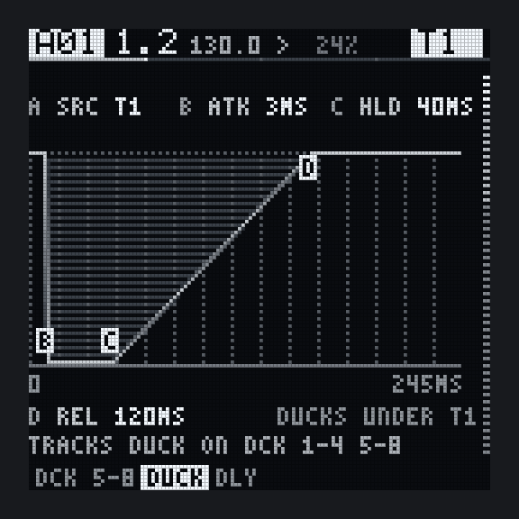</p>

Every time the **source track** plays a step, the other tracks dip in level for a moment and come
back: the classic pump that lets the kick through a dense bass and pad. It is fired by the
source's steps, not by listening to the audio, so it is tight and costs almost nothing. By
default the source is track 1 (the kick) and every other track ducks 35%.

It has three MIXER pages, right after the faders:

- **DCK 1-4** and **DCK 5-8**: knobs A-D are how far each track ducks, `OFF` (0) to `100%`. The
  source track shows `SRC`: a track never ducks under itself. The DUCK page says which track
  they duck under (`DUCKS UNDER T1`).
- **DUCK**: **SRC** (A) the source track, T1-T8. **ATK** (B) how fast the dip comes in, 1-50 ms.
  **HLD** (C) how long it stays down, 0-500 ms. **REL** (D) how long it takes to come back,
  10 ms to 1 s. Times are in milliseconds.

Short HLD and REL (0-40 ms, 60-120 ms) keep the groove tight; a long REL (300 ms and up) on
pads and the bass is the breathing house pump. To duck to a hat or a perc instead of the kick,
set SRC to that track. To turn the duck off, set every track's depth to `OFF`.

The duck is part of the **kit**: it is saved with the project and in the kit library, and a kit
recall brings its duck. A project or kit from before it was editable opens with the duck it
always had (track 1, 35%, 3/40/120 ms). Its settings are not p-lockable and not in scenes or
macros.

### Choke groups

A **choke group** makes tracks cut each other, the way an open hi-hat stops when the closed one
is hit. On MIXER's **TRK 1-4** and **TRK 5-8** pages, **push A-D** steps that strip's track
through `OFF`, group 1, 2, 3, 4 and back to `OFF`; the notice says which (`T4 CHOKE GROUP 1`) and
the strip shows `C1`-`C4` under its machine.

Any track can be in a group, a synth or a sample as much as a drum. A note on a track cuts every
other track of its group with a fade of about 1.3 ms, so there is no click. It works both ways:
in a group of an open and a closed hat, each cuts the other. Two tracks of a group that start on
the same 16th both sound. Only the track's own sound is cut: the echoes and reverb it already
sent ring on.

The groups are part of the **kit**: saved with the project and in the kit library. A project or
kit from before them opens with no track in a group. The HAT machine's own closed-to-open cut on
tracks 3 and 4 is separate and still works without a group.

### Ambient delay and reverb: LONG and HALL

<p> 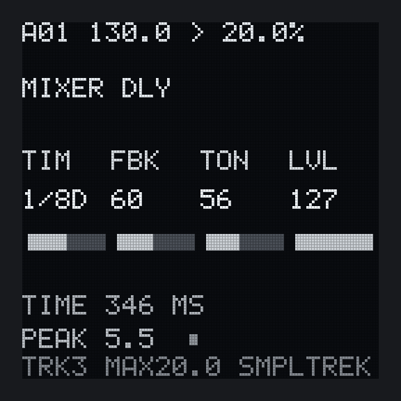</p>

<sub>MIXER's first page, all eight faders with A-D on tracks 1-4, and the DLY page. The screen keys walk all seventeen: TRK 1-4, TRK 5-8, DCK 1-4, DCK 5-8, DUCK, WID 1-4, WID 5-8, DLY, DLY+, REV, REV+, ROUTE, CHO 1-4, CHO 5-8, CHO, MST, EQ. UP/DOWN jump a group at a time, to its first page: the levels (TRK), the duck (DCK), the widths (WID), the delay (DLY), the reverb (REV), the chorus (CHO 1-4) and the master (MST).</sub>

Each send has a second mode for long, washy sounds. They sit on the MIXER pages beside their
send, `DLY+` after `DLY` and `REV+` after `REV`. **Push A** on either page (or turn A) flips the
mode; the old mode's echoes ring out underneath, so a switch never clicks.

- **LONG delay** (`DLY+`, A: `CLAS` / `LONG`). The echo time is DLY's division times **MUL**
  (B: `X1` to `X8`), up to **12 s**: `1/1 X4` is four bars. The page shows the time in
  milliseconds. **WOW** (C) is a slow tape wobble on the repeats; **DIF** (D) smears each repeat
  a little more than the last, so echoes turn into a wash after a few passes. The first echo is
  always clean and on the beat. FBK, TON, LVL and PNG work as in the classic mode, and ROUTE's
  **LCT** (C) cuts the lows from the repeats so a long tail stays clear of the kick and bass.
  Turning the time while it rings bends the echoes like tape, rather than jumping.
- **HALL reverb** (`REV+`, A: `ROOM` / `HALL`). A bigger, softer tail that moves slowly, so even
  a 30 s DEC never rings metallic. **SIZ** (B) is the size of the space, **MOD** (C) how much the
  tail drifts, **SHM** (D) feeds the tail back an octave up: a rising shimmer over held chords.
  DEC, DMP, HPF and LVL work as in the classic mode, and D>R sends the LONG delay into the HALL
  for the biggest wash.

The modes and their knobs are saved with the project; a project from before they existed opens
with both sends classic. Both cost more CPU than the classic modes while they sound (about
twice the send cost), and nothing once they fall silent.

### Stereo width: WID

The POLY machines, **VA POLY, WAVE POLY and FM4**, can play in stereo: their chords spread across
the field, or each note doubled into a detuned pair, hard left and right, which is the wide pad
and supersaw sound. One knob per track does both, on MIXER's **WID 1-4** and **WID 5-8** (after
DUCK), in zones as OS2 is:

- **0 (OFF)**: mono, as the track always played.
- **1-63 (spread)**: each note of a chord gets its own place, wider as the knob rises. The first
  note sits in the middle and the next ones go out to the left and right, so a single note stays
  centred and a triad fans out. No extra voices, so no extra notes are lost.
- **64-127 (unison, `UNI`)**: every note plays **two voices**, one hard left and one hard right,
  tuned apart from 6 cents at 64 to 40 cents at 127: a slow shimmer at the bottom, a thick
  supersaw at the top. A machine has six voices, so in unison it holds **three notes**, and each
  note counts two against the shared budget of 12 POLY voices. A fourth note takes the place of
  the quietest pair.

**Push A-D** steps a strip through OFF, a wide spread (48) and unison (96). A strip on a track
whose machine does not read WID shows `---` and says `POLY ONLY`; the setting stays for when the
track gets a POLY machine. PAN still works on a wide track, as a balance, and the sends, a bounce
and a freeze take the track's middle (a frozen wide track plays mono).

WID is part of the **kit**, saved with the project and in the kit library, but not a parameter:
FM4 has no free knob slot, so no lock, scene or LFO moves it. A project or kit from before it
opens with every track mono. Spread costs a little (each voice is panned and the track's chain
runs twice); unison costs the voices it adds (docs/BUDGET.md "Stereo width").

### Chorus: the third send

A stereo chorus for keys, pads and anything that should sound wider. It is a **send**, like the
delay and the reverb: each track sends as much of itself as you like, and the chorus adds a
widened, gently detuned copy back to the mix beside the dry track. One chorus serves all eight
tracks, so it costs the same whether one track uses it or eight, and nothing at all while no
track sends to it.

- **CHO 1-4** and **CHO 5-8** (MIXER, after ROUTE): A-D are each track's chorus send, OFF to 127,
  shown as a bar standing up from the bottom of its strip. **Push A-D** throws a strip between
  OFF and half (64), the quick way to try it on a track. A strip says `T7 CHORUS 64` as it moves.
- **CHO**: **RAT** (A) the sweep's speed, 0.05 to 5 Hz (slow is a lush ensemble, fast a warble);
  **DEP** (B) how far the sweep swings, up to 5 ms either side of 8 ms; **LVL** (C) the chorus's
  return; **C>R** (D) how much of the chorus goes on into the reverb. The page draws the two
  sweeps, left and right a quarter turn apart, which is what makes a mono track come back wide.

The send is post-fader, as SNA and SNB are. Unlike them it is a kit setting rather than a
parameter, because every track's 32 parameter slots are taken: a lock, a scene or the LFO does not
move it. The sends are saved with the kit (and in the kit library), the chorus's four knobs with
the project. A project or kit from before the chorus opens with no track sending to it.

### Freeze

CPU is the SmplTrek's tight resource and memory is not, so a track can be **frozen**: it plays
a loop of itself from RAM instead of computing its sound. FUNC+HOME opens the menu; **FREEZE** is
near the end (UP four times from SAVE, since the list wraps). The row shows the selected track and the loop's length, `T7 1 BAR`;
LEFT/RIGHT or B pick 1, 2, 4 or 8 bars. OK arms it (`FREEZE ARMED`, or `ARMED: PRESS PLAY`
when stopped): from the next bar line the track's machine is recorded for that many bars, and
then the screen says `FROZEN` and the track plays the recording.

A frozen track keeps its **insert filter, drive, lo-fi, fader, pan, sends and duck**: they work
on the loop live. What stops is everything that feeds the machine: notes, steps, locks, chords
and the knobs on its SRC/AMP pages do nothing, and EDIT says `FROZEN: FUNC+HOME`. To change the
part, unfreeze it: the FREEZE row reads `T7 ON`, and OK gives the machine back at once
(`UNFROZEN`). The loop keeps in time with the bar lines; after a tempo change it jumps back into
time at the start of its next loop rather than stretching. A frozen track is silent while
stopped. Loading a project, NEW and recalling a kit unfreeze every track, and a freeze is not
saved: the project always opens live.

A freeze is a take, so it waits while a RESAMPLE take is running, and the RESAMPLE screen waits
for a freeze. The loop uses the sample memory (a bar at 120 BPM is about 190 KiB); if there is
not room, the screen says `NO ROOM` and the track stays live. MID tracks have no audio to
freeze. To keep a loop as a sample you can slice or reverse, bounce it instead (RESAMPLE, B on
`TRK n`).

### Mutation

In PERFORM, UP/DOWN pick the mutation and the screen keys the amount (0-100, in tens):

| Mutation | What it does |
| --- | --- |
| ROT LEFT / ROT RIGHT | Rotate the track by a step |
| DENSITY + / DENSITY - | One Euclidean hit more or fewer |
| VELOCITY | Velocities move by up to ±48 |
| MICRO | Micro-timing moves by up to ±11 ticks |
| CHANCE | Probability moves by up to ±40 points |
| NOTES | Notes move by up to ±3 scale degrees |

The ranges are at amount 100; amount 0 changes nothing. Each press gives a new result. Results
are seeded, so the same press on the same pattern gives the same result again.

### Resampling

<p>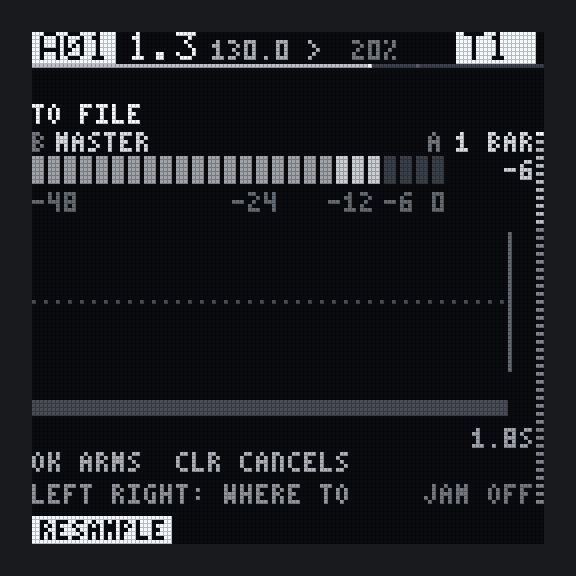</p>

`FUNC+REC` opens RESAMPLE. UP/DOWN or A set the length (1, 2, 4 or 8 bars); LEFT/RIGHT or the
screen keys set where it goes: `TO FILE`, or `TO TRK n`. OK arms it (`ARMED`), and the take
starts on the next bar line (`REC 40%`), records the finished master including repeat and
effects, and is written to `/RECORD/STRATA_<n>.WAV` (`WRITING`, then `LAST STRATA_n`). With a
track as the destination, the take also becomes that track's sample and loads straight away, so
an 8-bar jam can become the loop on track 8 for SAMPLE or GRAIN. A take is at most 30 s
(`SHORTENED TO 30S`). CLR cancels.

**Put it on a track afterwards.** A take that went `TO FILE` is offered to a track as soon as it
is written: `PUT ON TRK 3 GRN`, `OK PUTS  CLR KEEPS`. OK makes it that track's sample at once
(`T3 GRN: TAKE ON`); LEFT/RIGHT pick another track first; CLR leaves it a file. The first track
offered is a SAMPLE or GRAIN track other than the one you bounced, so the usual case is one OK.
A track playing a synth is refused (`T1 NOT SAMPLE/GRAIN`): give it SAMPLE or GRAIN first.

**Sampling from the input.** B picks where the take comes from: `MASTER` (the default) or one of
the inputs, `LINE` (INPUT L and R), `LINE L` (INPUT L alone, on both sides), `MIC` (the built-in
microphone, which Enaga keeps silent unless headphones are in: the screen says
`MIC NEEDS HEADPHONES`), `DYN MIC` (INPUT R through the mic preamp) or `HI-Z` (INPUT L for a
guitar). C sets the input level, `LOW`, `NORM` or `HIGH` (on LINE, LOW is the -20 dB pad). An
input shows a meter under `FROM ...`; set the level so it does not reach `CLIP`. The take is the
input alone, before anything STRATA plays, and otherwise works exactly like a master take: it
starts on the next bar line with the transport running, lasts 1-8 bars, and lands in a file or
a track. You do not hear the input through STRATA; listen to the source directly. Turning B or C
makes the input quiet for about 10 ms, and Enaga puts the input back to LINE, NORM when STRATA
stops.

**Bouncing one track.** Past the inputs, B also offers `TRK 1` to `TRK 8`. The take is then that
track alone: its machine through its drive, filter and lo-fi, before its duck, fader, pan and
sends, so a quiet or panned track still comes out at full level, and the duck is not baked in.
It is mono, half the size of a master take. With `TO TRK n` it lands on that track like any
take, ready to slice, reverse or put on GRAIN; give that track SAMPLE or GRAIN to hear it. A
muted track bounces as silence, so unmute it first.

### Recording the whole jam: JAM REC

RESAMPLE keeps 30 seconds. To keep a whole set, use **JAM REC**: press **FUNC+REC twice**, once
for RESAMPLE and again to start it (`JAM REC JAM 3`). A dot blinks in the top bar before the load,
the REC key blinks a dim red, and everything that comes out of STRATA goes to
`/RECORD/JAM_<n>.WAV` until you stop it with FUNC+REC on RESAMPLE again (`JAM STOPPING`, then
`SAVED JAM 3`). RESAMPLE's last line shows how long it has run, `4:07` or `1:02:33`, and the key
that stops it. The FUNC menu's JAM REC row does the same, with the time on the row.

It records what RESAMPLE's MASTER take hears: every track, the sends, the master effects,
REPEAT and the tape stop. The metronome and the sample browser's audition are for you and are
never on it. It runs through starts and stops of the transport, pattern and project changes,
RESAMPLE, freeze and the looper. The file is 48 kHz 24-bit stereo, about 1 GB an hour; each jam
gets the next number, so none replaces an earlier one.

It stops on its own, and keeps everything up to that point, when the card is full
(`CARD FULL: JAM SAVED`) or after 3 hours 51 minutes, where a WAV file on the card has to end
(`4 HOURS: JAM SAVED`). Pulling the card cuts it (`CARD OUT: JAM CUT`): the audio that reached the
card is there, but its header could not be written, so some players call it empty. Switching
STRATA off with a jam running closes the file properly. If the card is too slow, `JAM: CARD TOO
SLOW` says so and the file skips the blocks that did not fit; use a faster card.

### What moves on screen while it plays

While the transport runs, the screens move with the music; stopped, they hold still, so a
change on screen always means a key or knob did something.

- **GRID**: each trig that plays lights an outline round its cell that fades in about a third
  of a second, a trail behind the playhead.
- **PERFORM**: the four macros are round gauges, bright up to where each macro is, with a needle
  and the value under it (a dot outside the ring marks the knob while a pad's pressure moves the
  macro). Behind them glows a dim scope of what comes out, and under the REL/LEN line a row of
  eight meters shows each track's level, a muted track dim.
- **EDIT's LFO page**: while the LFO runs, one cycle of its shape with a dot riding it at the
  LFO's phase, and beside it a strip of what the LFO put out over the last two seconds.
- **EDIT's envelopes** (AMP, ENV): a dim fill under the curve, lit under the part the
  playing note has travelled.

SETUP shows what a frame of the screen costs to draw (`DRW 0.85MS`); docs/CONTROLS.md, "The
screen frame", has the details.

---

## 6. Saving, loading and the card

### Saving

<p></p>

- **Save:** `FUNC+HOME`, then `OK` (the FUNC menu opens on SAVE). Only the files that changed are written, and the
  audio keeps playing.
- **Autosave:** every time the transport stops (from STOP or from an outside clock), and when
  you leave the app through the Enaga menu, into `AUTOSAVE/`.
- **At start**, STRATA reopens the last project, or its autosave if that is newer. A first run
  gets the factory project, named `DEFAULT`.
- **UNSAVED** on the PROJECT screen means RAM differs from the card.

### Reload and new

In the FUNC menu (FUNC+HOME), each with OK twice within 2 s:

- RELOAD PROJECT (`OK AGAIN TO RELOAD`): read the project back from its last save, throwing away
  what is unsaved.
- NEW PROJECT (`OK AGAIN FOR NEW`): a new, empty project named `NEWn`: the factory sounds and
  mixer with every pan centred, but no steps, chain, scenes, macros or mute states. Nothing is
  written until you save it, so the old project is untouched.
- LOAD DEMO (`OK AGAIN FOR DEMO`): the factory demo project, the beat a first start plays, under
  a new name. Again nothing is written until you save.

All three stop the transport.

### Projects: open, save as, rename and delete

<p></p>

PROJECT, then screen key RIGHT four times (or the FUNC menu's OPEN PROJECT), is the PROJECTS page: every project folder on the card,
with `NOW` and the open one's name at the top. UP/DOWN or A move the cursor, LEFT/RIGHT go a page
of eight at a time.

- **Open:** OK on a project, then OK again within 2 s (`AGAIN TO OPEN`). What is unsaved in the
  open project is thrown away and the transport stops, as with a reload. STRATA starts with that
  project from now on.
- **Save as:** `FUNC+DOWN` here, or the FUNC menu's SAVE AS, opens a name entry starting from the current name. A or LEFT/RIGHT
  move along it, B, VALUE or UP/DOWN change the character under the cursor (A-Z, 0-9, space and
  `- + . # !`, up to 16), OK saves, CLR cancels (`NAME KEPT`). The project is written whole into
  a new folder and carries on under the new name; the old folder stays as it was saved. A name
  another project already has is refused (`NAME TAKEN`): open that one instead.
- **Rename:** push B on a project opens the same name entry, titled RENAME and starting from
  that project's name. OK renames it (`RENAMING`), CLR leaves it (`NAME KEPT`); a name another
  project has is refused (`NAME TAKEN`). The open project can be renamed too: it carries on under
  the new name, and STRATA starts with it. Unsaved work stays unsaved; the rename moves what is
  on the card.
- **Delete:** push C on a project asks `DELETE? OK TWICE`; OK, then OK again within 2 s
  (`OK AGAIN TO DELETE`), deletes its folder and everything in it (`DELETING`). CLR, or any other
  key, keeps it. The open project cannot be deleted (`PROJECT IS OPEN`): open another one first.
  A delete cannot be undone.
- `FUNC+UP` reads the card again. CLR goes back to the slots.

Both are safe if the card is pulled or the power goes in the middle. The unit's file system has
no rename, so a rename copies the project into the new folder, its `PROJECT.BIN` last, and only
then deletes the old one: at any moment there is at least one whole copy, and at worst two. A
delete removes `PROJECT.BIN` first, so a folder it did not finish is no longer a project
(opening it says `NOT FOUND`, never a project with patterns missing); delete it again to finish.
A delete that finds a folder inside the project's folder (put there from a computer) removes
everything else and says `FOLDER NOT EMPTY`.

### Starter projects and the sample pack

The card builder can add ten starter projects, each a short arrangement in its own style, built
from the factory sounds and opening with the chain on:

| Project | Style | Tempo, key |
| --- | --- | --- |
| TECHNO | Driving groove techno | 132, G minor |
| DEEP | Deep house, FM4 e-piano chords | 122, A minor |
| DUB | Dub techno, one chord into a long echo | 118, F minor |
| DRIFT | Ambient, WAVE POLY chords in the HALL | 80, D dorian |
| ELECTRO | 808 kit, rubbery bass, a synced lead | 128, E phrygian |
| NIGHT | Synthwave over a breakbeat | 132, A minor |
| BREAKS | A synthesized break that changes by chance | 134, A minor |
| STEEL | Straight breaks, ratchets, a driven reese | 140, E minor |
| SMASH | Drum chaos, ghosts and rolls | 155, F minor |
| CHAOS | BREAKS pulled apart: rolls to 1/64, constant mutation | 150, D phrygian |

Open one on the PROJECTS page like any other project. A changed starter project is yours to keep:
save it, or SAVE AS a new name to keep the original as it came. They need STRATA 0.5.0 or newer.

The sample pack, in `/SAMPLES/STRATA`, holds 105 files in DRUMS, PERC, BASS, LEADS and CHORDS,
each rendered by one of STRATA's own machines from a factory sound. Melodic files name their
note (`MONO_ACID_C2`): played at C4 on a SAMPLE track they sound at that note. `M7` files are C
minor seventh chords.

### The kit library

<p>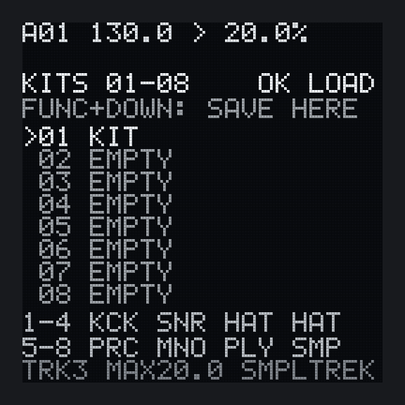</p>

`FUNC+EDIT` twice opens KIT. Sixteen slots, two pages of eight; each shows `KIT`, `EMPTY`,
`UNREADABLE` or `...` (not read yet), and the kit under the cursor is listed as its eight
machines. UP/DOWN, A or the STEP keys move the cursor (they never load).

- **Recall:** OK, then OK again within 2 s (`OK AGAIN TO LOAD`). The transport keeps playing; only
  tracks whose sample changed reload theirs. Everything the kit holds comes back, MOD slots,
  choke groups and arp settings included. A recall is **not undoable**.
- **Store:** `FUNC+DOWN` stores the current kit; over a stored kit it needs a second press
  (`AGAIN TO OVERWRITE`).
- `FUNC+UP` reads the card again. CLR goes back to MACHINE.

A recalled kit makes the project UNSAVED until you save it.

### Samples

Samples load into RAM in the background: the track stays silent until its sample is
ready, and everything else keeps playing. The PROJECT screen's `SMP` line shows each track (`O`
loaded, `S` streamed from the card, `.` loading, `X` failed, `-` none) and the memory used out of
the budget, `12/64M`.

STRATA reads WAV files: 8, 16 or 24-bit, or 32-bit float, mono or stereo, at any sample rate
(other rates are converted to 48 kHz on load).

- **At 48 kHz a file may be any length that fits the sample memory.** With the project's 64 MiB
  that is about 5.8 minutes of stereo, or 11.6 of mono, shared by all tracks; the hard limit is
  349 s. A long file is read in pieces (`LOADING LONG` and a percentage), about 7 s for a 50 MB
  stem, while everything keeps playing, and then plays like any other sample: pitch, slices,
  GRAIN.
- **At any other rate** a file is converted whole, so it may be up to **30 s at 96 kHz**; at
  lower rates the same buffer holds more (about 65 s at 44.1 kHz). Save long stems at 48 kHz.
- **A file too big for all that is streamed** from the card instead: one too big for the sample
  memory left, longer than 349 s, or at another rate and longer than the above. Its first two
  seconds load into memory and the rest is read while it plays; the SMP line shows `S` for the
  track. A streamed file plays from its start, forward, on one voice: pitch, the note, ATK, DEC,
  LVL, loop and LEN (where it stops, or loops back from) work, but START, slices and reverse do
  not, and on GRN only the first two seconds play. The card can only be read forward from where
  a stream was opened, and every jump costs a search through the file system that grows with the
  file, so a start anywhere but the beginning or playing backwards would need the card to jump
  all the time; docs/FEATURES.md has the numbers. Up to four tracks can stream at once. If the card cannot keep up, the gap plays
  as silence, the loop stays in time and the screen says `STREAM LATE`; a fast card (class 10 or
  better) avoids it.

### Picking a sample: the sample browser

<p></p>

On a SMP track, press **OK** in EDIT (the page says `OK: PICK SAMPLE`) or in MACHINE; on a GRN
track, OK in MACHINE (OK in EDIT opens its SOUNDS). The
browser opens in the folder of the file the track plays, with the cursor on it, or in `/SAMPLES`
(in the SmplTrek's sample pool when the card has that and no `/SAMPLES`).

- UP/DOWN (or A) move the cursor, LEFT/RIGHT or the screen keys turn a page of eight.
- **OK on a file loads it into the track at once**, with the beat playing, and the cursor stays
  put: press DOWN and OK again to try the next one. A toast says `READING`,
  `CONVERTING` and so on while it loads, and the `NOW` line shows the file the track plays.
- **On a SMP track a picked file plays whole, from its start**: the pick sets STA 0, LEN 127,
  SLC 1 and DEC 127 (hold). PIT, ATK, PLY and LVL stay as they were. Turn SLC up afterwards to
  chop it. A project or kit you open keeps the values it was saved with, and a GRN track's knobs
  are left alone.
- **Push A to hear a file first.** It plays the file under the cursor, whole and from its
  start, straight to the output at about -6 dB, without loading it: the track and the kit stay
  as they were. Push A again to stop. **With the beat playing it takes two pushes**: the
  first only says `A AGAIN TO HEAR`, and a second push on the same file within 2 s plays it.
  The SmplTrek has no separate cue output, so the audition goes out with the beat, and a single
  bump of the knob in a set should not put a file into the room. While a file is heard, UP/DOWN (or turning A, or a page)
  hears the next file the cursor lands on, so you can listen down a folder and press OK on the
  one you want. A toast says `HEARING 3/12S` (seconds heard of the file's
  length, `OPENING` for the moment before it sounds), and a line under the file's name grows as
  it plays. It is streamed from the card, so a long
  stem starts as quickly as a short hit, plays at its own rate and takes no sample memory. It is
  not recorded by RESAMPLE or the looper and goes round no effect. OK (which loads it), CLR,
  another folder, a folder under the cursor or leaving SAMPLES stops it. A file that cannot be
  heard says why (`NOT A WAV`, `BAD RATE` for rates outside 8-96 kHz, `NOT FOUND`).
- OK on a folder (shown with a `/`) opens it. **CLR goes up a folder**; at the top are `SAMPLES/`
  and `RECORD/` (your resampled takes), and CLR from there goes back to where you came from.
- **The SmplTrek's own folders.** On a card the stock firmware has used, the top also shows
  `POOL/`, the stock sample pool (`/SmplTrek/Pool/Audio`, where the SmplTrek manual says to copy
  WAVs), and `SMPLTREK/`, the stock firmware's whole tree: `Project/<name>/Audio` holds each stock
  project's own samples, `Preset/` the factory ones. STRATA only reads there and never changes
  the stock folders; your kit remembers the file's full path and loads it from there next time.
- `FUNC+UP` reads the folder again, for a card swapped or a take just written.

Only WAV files and folders are listed; macOS's `._` files are hidden. A folder shows its first
256 entries; the count line says `+n` when it left some out, and also counts names too long to
store (a sample's whole path, folders included, may be 111 characters). Picking a file makes the
project UNSAVED, like any kit change. Names are shown in capitals, with characters the screen
cannot draw (such as `_`) shown as `-`.

A track also gets a sample by **resampling into it** (section 5) or by **recalling a kit** that
names one.

---

## 7. Performance tips

- **Build tension with locks, not new patterns.** One trigless step with a FLTR lock, or a bass
  RES lock on the accent, makes a pattern feel alive for longer than a copy does.
- **Use odd track lengths.** A 7-step loop or a 12-step perc against 16 never repeats exactly
  for several bars, and costs nothing.
- **Probability on the decorations.** 50-70% on a rim or a loop slice keeps a groove moving; keep
  the kick and the clap at 100%.
- **Keep side A empty.** Then the morph always starts from the sound you have, and B is the
  destination. Swap B's scene with SCENE B + STEP between sections.
- **Queue with END.** Changes land on the bar and nobody hears the seam. Use NOW for a hard cut.
- **Ride a factory macro over a build.** B ACID over 8 or 16 bars, then back to 0 for the drop:
  0 is always exactly where you started.
- **Mutate, then decide.** MUTATE is free to try: CLR takes it back, and FUNC+CLR undoes even a
  kept one later.
- **Pump the pads, not the hats.** Set the chord and pad tracks' duck to 60-80% with a long REL
  on the DUCK page and the hats to OFF: the pads breathe with the kick and the top end stays
  steady.
- **Kill the lows for the build.** FUNC+A takes the kick and bass out; push it again exactly on
  the one of the drop. FUNC+C on its own thins a busy top end for a breakdown.
- **Snare rolls into the drop.** FUNC+FILL, then hold the snare's pad and press harder over the
  last bar; REPEAT + VALUE to 1/32 for the final beat.
- **Tape stop into the drop.** Push VALUE + STEP 8 and turn VALUE up on the last two beats of a
  build, then tap VALUE exactly on the one. Or throw the chord into the delay, then slot 5 near
  the top to keep the echo as a pad, or slot 7 (MUTE BUS) to drop the beat out under its tails.
- **Loop, then rebuild underneath.** Push VALUE + STEP 16 to catch four bars, turn VALUE up to
  hold them, then mute, switch patterns or edit live and fade back when the new part is ready.
- **Throws on the off-beat parts.** THROW on the rim or the chord for a bar, then let it ring.
- **Resample a moment you like.** An 8-bar take of a jam into track 8, then sliced or on GRAIN,
  turns a happy accident into material.
- **Save before a set**, and remember that STOP autosaves.

---

## 8. Troubleshooting

### The audio load: LOAD and MAX

The top line's last figure, `23%`, is how much of each audio block the DSP used: the **load**.
It changes every block, so it flickers. PROJECT's SETUP page holds **MAX** (`MAX 27.0%`): the
highest block since PLAY was last pressed, so press PLAY to start a fresh reading.

STRATA is designed to stay under 60% in its worst case. On the unit the default beat reads
under 30%, and long, heavy play has peaked at 84% without a dropout. If the load climbs or the
sound crackles:

- **VA POLY, WAVE POLY and FM4** are the biggest cost: every chord note is a sustaining voice. Use shorter DEC, fewer
  notes per chord (MIN rather than MIN11), or fewer POLY tracks. All POLY tracks share 12 voices,
  and a unison note (WID 64 and up) counts two.
- **GRAIN** with high DEN is eight grains at once; lower DEN or use SAMPLE.
- **The CPU guard** steps in on its own when the load stays high: the tabs' line shows
  `GUARD1` to `GUARD4` at its right, POLY chords get thinner (two voices fewer a step, the quietest fading
  out first) and GRAIN clouds get sparser. It steps back down one level a second once the load
  falls, and a second STOP clears it. Seeing `GUARD` often means the pattern asks for more than
  the box has: use the tips above.
- **Freeze the dearest track.** FUNC+HOME, UP four times to FREEZE, OK: the selected track
  records its loop (1 bar; LEFT/RIGHT or B on the row for 2, 4 or 8) from the next bar line, then
  plays it from memory and stops computing. A six-voice POLY chord goes from the biggest cost
  in the project to almost nothing. See "Freeze" in section 5.
- **The insert filter and lo-fi** cost nothing when off. Set FLTR MOD to OFF and LOF to 0 on the
  tracks that do not need them.
- **Closed sends** cost nothing: keep SNA and SNB at 0 on tracks that do not use the delay or
  reverb. The chorus costs nothing while no track's CHO send is up.

### Sample messages

Shown on the PROJECT screen under the project name, and the track shows `X` on the SMP line.

| Message | Meaning | What to do |
| --- | --- | --- |
| `TOO LONG` | Longer than six hours | Trim it |
| `NO ROOM` | Does not fit in the sample memory left (`SMP ... nn/64M`), not even its first two seconds to stream | Use shorter or mono samples, or free a track |
| `STREAMS FULL` | Four tracks already stream | Free one of them, or use a shorter file that fits in memory |
| `STREAM FAILED` | The card would not open the file for streaming | Check the card; pick the sample again |
| `STREAM LATE` | The card fell behind a streamed file: a gap played as silence | Use a faster card, fewer streamed tracks, or 16-bit files |
| `NOT A WAV` / `BAD FORMAT` | Not a WAV STRATA reads | Export as 16 or 24-bit PCM WAV |
| `TOO MANY CH` | More than two channels | Export as mono or stereo |
| `EMPTY` | No audio in the file | |
| `NO SAMPLE` | the FUNC menu's RELOAD SAMPLE on a track whose kit names no file | |
| `NO CARD` | The card is missing or unusable | Reinsert it; samples reload by themselves |
| `NO SWAP` | The sample handover did not complete | A bug: please report it |

### External clock

<p></p>

The clock source is a unit setting, not STRATA's: **FUNC+POWER** opens the Enaga menu with CLOCK
SRC (INTERNAL, MIDI, SYNC), CLOCK/SYNC OUT and MIDI CH. PROJECT's SETUP page (PROJECT, screen
key RIGHT three times) shows them.

Under MIDI or SYNC, the top line shows `MIDI` or `SYNC` where the tempo was, and STRATA **follows**: PLAY, STOP,
FUNC+PLAY, FUNC+STOP and the tempo knob are refused with `EXT CLOCK` while the outside clock
runs. Start and stop from the master instead; STRATA follows, and still autosaves on its stop.
`CLOCK REFUSED` means the last transport request was refused. Reloading a project or starting a
new one needs the transport stopped, so stop the master first.

### Other messages

| Message | Meaning |
| --- | --- |
| `LOADING` on PLAY | A project is still loading; PLAY works when it finishes |
| `FULL n` on GRID | n locks refused because the pattern's 1,024-lock pool is full |
| `DROP n` at the right of the tabs | n edits were lost because they came faster than the audio side applies them |
| `GUARD n` at the right of the tabs | The CPU guard is shedding POLY voices and GRAIN grains to keep the load under the limit (see "The audio load") |
| `UNREADABLE` in KIT | That kit file is damaged |
| `PATTERN LOST` or another reason on PROJECT after a load | The card held a damaged file; STRATA refuses damaged files rather than crashing |

### When nothing makes sense

- **FUNC+STOP** resets the transport, the queue and the chain.
- **FUNC+CLR** undoes the last edit, up to 16.
- **FUNC+HOME, OK** saves; the menu's RELOAD PROJECT (OK twice) reloads the last save.
- **FUNC+POWER** leaves for the Enaga menu; STRATA autosaves on the way out.

---

<sub>STRATA is an independent project, not affiliated with or endorsed by Sonicware. SmplTrek is a
trademark of its owner. Provided as is, without warranty; use at your own risk (see LICENSE).</sub>
